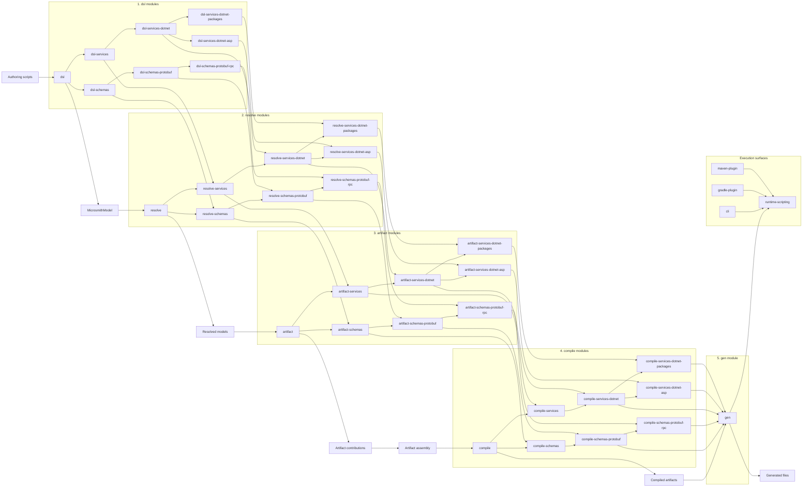

# Architecture

## Generation architecture

Microsmith generation is organized into five explicit stages:

1. `dsl-*`: authoring-facing builders and immutable extension models
2. `resolve-*`: normalization, inheritance application, and semantic validation into finalized domain models
3. `artifact-*`: logical artifact creation and contribution assembly
4. `compile-*`: artifact-to-artifact compilation into renderable file artifacts
5. `gen`: final rendering, output routing, and file writing

Generators consume finalized models and compiled artifacts instead of raw authoring DSL state.

The graph below shows the central runtime data flow and the Gradle subprojects that participate in each stage.

`runtime-scripting` and `cli` currently bundle the schema and protobuf provider stack from resolver, artifact, compiler, and renderer provider modules.

### Provider responsibilities

Microsmith’s pipeline is extensible through explicit provider roles:

- `DomainResolver`: transforms one top-level authoring extension into a finalized resolved model
- `ArtifactContributor`: contributes logical artifacts or artifact contributions from a resolved model
- `ArtifactAssembler`: merges contributions for a specific artifact family into a stable logical artifact
- `ArtifactCompiler`: compiles a logical artifact into more concrete artifacts until only renderable file artifacts remain
- `ArtifactRenderer`: renders a final file artifact into a `GeneratedFile`

This keeps the layering explicit:

- `dsl-*` defines authoring surfaces
- `resolve-*` finalizes and validates domain state
- `artifact-*` defines mergeable logical contracts
- `compile-*` translates logical artifacts into renderable file artifacts
- `gen` renders final file artifacts and writes outputs

## Repository modules

- `dsl`: core DSL primitives, builders, model types, and extension APIs
- `dsl-schemas`: generic schema registry and schema-oriented DSL surface
- `dsl-schemas-protobuf`: protobuf-flavoured schema DSL on top of `dsl-schemas`
- `dsl-schemas-protobuf-rpc`: protobuf service and RPC DSL extensions on top of `dsl-schemas-protobuf`
- `dsl-services`: generic service registry and service-oriented DSL surface
- `dsl-services-dotnet`: .NET service defaults, identity, and model DSL support
- `dsl-services-dotnet-asp`: ASP.NET service-generation DSL support on top of `dsl-services-dotnet`
- `dsl-services-dotnet-packages`: .NET package ownership and package reference DSL support
- `resolve`: base resolution contracts and resolved-model orchestration
- `resolve-schemas`: schema-domain resolved model support
- `resolve-schemas-protobuf`: protobuf schema finalization and validation
- `resolve-schemas-protobuf-rpc`: protobuf RPC finalization and validation
- `resolve-services`: service-domain resolved model support
- `resolve-services-dotnet`: finalized .NET service workspace resolution
- `resolve-services-dotnet-asp`: finalized ASP.NET service workspace resolution
- `resolve-services-dotnet-packages`: finalized .NET package workspace resolution
- `artifact`: shared artifact contracts, assembly, and contribution infrastructure
- `artifact-schemas`: schema-domain artifact contracts
- `artifact-schemas-protobuf`: protobuf artifact types and contributions
- `artifact-schemas-protobuf-rpc`: protobuf RPC artifact types and contributions
- `artifact-services`: service-domain artifact contracts
- `artifact-services-dotnet`: .NET/MSBuild artifact types and assembly
- `artifact-services-dotnet-asp`: ASP.NET service artifact types and contributions
- `artifact-services-dotnet-packages`: .NET package artifact types and contributions
- `compile`: artifact compiler contracts and recursive artifact compilation
- `compile-schemas`: schema-domain compiler contracts and shared schema compilation entrypoints
- `compile-schemas-protobuf`: protobuf artifact compilation into file artifacts
- `compile-schemas-protobuf-rpc`: protobuf RPC artifact compilation into file artifacts
- `compile-services`: service-domain compiler contracts and shared service compilation entrypoints
- `compile-services-dotnet`: .NET/MSBuild artifact compilation into file artifacts
- `compile-services-dotnet-asp`: ASP.NET project and source-file compilation from normalized REST models
- `compile-services-dotnet-packages`: .NET package artifact compilation into file artifacts
- `gen`: final file rendering, output routing, and generation orchestration
- `runtime-scripting`: Kotlin scripting host for `.microsmith.kts` execution and built-in provider loading
- `cli`: command-line entrypoint, diagnostics, installer packaging, IDE helper support, and built-in provider validation
- `gradle-plugin`: native Gradle integration for `.microsmith.kts` execution and imported-project IDE alignment
- `maven-plugin`: native Maven integration for `.microsmith.kts` execution and imported-project IDE alignment

### Module boundary map

- `dsl-*` modules own authoring ergonomics only. They may model layered defaults and rich DSL entrypoints, but they should stay free of output routing, rendering, scripting-host concerns, and filesystem writes.
- `resolve-*` modules own finalization. They apply inheritance and defaults, validate cross-object semantics, and produce generator-facing immutable models. They must stay pure and avoid rendering or output-path concerns.
- `artifact-*` modules own logical artifacts and artifact contributions. They define what exists before rendering, how same-artifact contributions merge, and where conflicts are rejected.
- `compile` owns the shared artifact-compilation contracts and recursive compilation loop. `compile-schemas` and `compile-services` own domain-root compile contracts, while feature compile modules own concrete artifact-to-artifact transformations.
- `gen` owns final rendering, output routing, and shared generation orchestration.
- `dsl-schemas*`, `resolve-schemas*`, `artifact-schemas*`, `compile-schemas*`, and `gen` form the current schema-domain generation path. Keep protobuf-specific behavior in the protobuf-specific modules rather than bloating the generic schema layers.
- `dsl-services*`, `resolve-services*`, `artifact-services*`, `compile-services*`, and `gen` form the current service-domain generation path. Keep .NET, ASP.NET, and package-management behavior in the feature-specific service modules rather than bloating the generic service layers.
- `runtime-scripting` is the scripting host and execution boundary. It may depend on DSL and generation layers, but it must not absorb CLI parsing, onboarding, or distribution concerns.
- `cli` is the application layer for command parsing, diagnostics, repository onboarding, plugin resolution, installation, and JetBrains IDE helper workflows. Lower layers must not depend on `cli`.
- `gradle-plugin` is the native Gradle integration surface for Gradle-imported JVM repositories. It should stay thin, Gradle-conventional, and explicit about task/configuration wiring rather than absorbing CLI concerns.
- `maven-plugin` is the native Maven integration surface for Maven-imported JVM repositories. It should stay thin, Maven-conventional, and explicit about plugin configuration, generated-source wiring, and imported-project IDE expectations rather than absorbing CLI concerns.

## Repository layout

- `modules/`: production Gradle subprojects, grouped by capability:
  - `engine/`: the pipeline stages `dsl`, `resolve`, `artifact`, `compile`, and `gen`
  - `schemas/`: schema targets under `base/`, `protobuf/`, and `protobuf-rpc/`
  - `services/`: service targets under `base/`, `dotnet/`, `dotnet-asp/`, and `dotnet-packages/`
  - `runtime/`: the scripting host and its API
  - `integrations/`: `cli`, `gradle-plugin`, and `maven-plugin`
- `build-logic/`: included Gradle build that owns repository-specific plugins and quality tasks
- `examples/`: consumer-repository fixtures and onboarding examples
- `docs/`: user and contributor documentation
- `gradle/`: wrapper files, version catalog, and dependency locks
- `.github/`: workflows and repository automation
- repository root: shared build files, license, and top-level contributor entrypoints such as `README.md`, `build.gradle`, and `settings.gradle`

[Back to the README](../README.md)
