# Dependency injection in 4.0

**Status:** Proposed

**Milestone:** v4.0.0, together with #203 (explicit API mode)

## Summary

Today only `gen` uses Metro. Every other module builds its own collaborators, keeps behaviour in `object`s, and calls the file system, clock, environment and processes directly. Plugins join through seven `ServiceLoader` contracts, and the host blocks on every coroutine.

In 4.0:

- Every service gets its collaborators through its constructor.
- The host has three nested lifetimes: the app (one per JVM), the script run (one per script) and the generation run (one per `generate` call, with its own Metro graph).
- Plugins join through two contracts: `MicrosmithPlugin`, which is required, and `MicrosmithScriptingPlugin`, which is only for plugins that add script symbols.
- Each plugin has a stable id, builds its own graph from the host services it is given, and is closed when its generation run ends. No Metro type crosses the plugin boundary.
- I/O, time and processes sit behind injected seams, so unit tests can replace them. Plugins receive five of them through `HostServices`.
- The host API is `suspend` from each composition root down, so cancellation reaches generation and child processes.
- The change ships with #203 and moves one module family at a time.

## The design at a glance

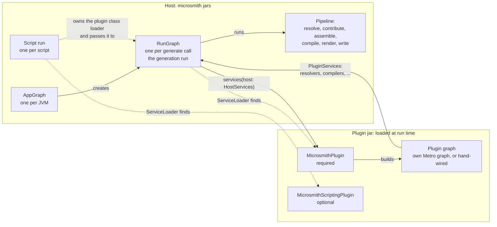

Only four microsmith entry interfaces cross between the two boxes. `MicrosmithPlugin`, `HostServices` and `PluginServices` are always used. `MicrosmithScriptingPlugin` is used only by a plugin that adds script symbols.

## Glossary

| Term | Meaning here |
|---|---|
| Service | An object that does work: a resolver, a renderer, a writer. Contrast with a value, such as `ResolvedProtobufMessage` or `GeneratedFile`. |
| Graph | A Metro `@DependencyGraph`: an interface from which Metro generates the code that builds services and their collaborators. |
| Binding | A rule in a graph that says how to get one type, such as an `@Inject` constructor or a `@Provides` function. |
| Scope | A marker type that ties an instance to a graph's lifetime. `@SingleIn(RunScope::class)` means one instance per `RunGraph`, which is one generation run. |
| Script run | One `ScriptRunRequest`: one script, compiled and evaluated once. It owns the plugin class loader and the script compile cache. It contains zero or more generation runs. |
| Generation run | One `generate` or `emit` call. It gets its own `RunGraph` and its own plugin graphs. |
| Graph extension | A Metro `@GraphExtension`: a child graph created from a parent. It sees the parent's bindings and lives for a shorter time. |
| Contribution | A Metro annotation such as `@ContributesTo` or `@ContributesIntoSet` that adds a binding to a graph from another module. Metro gathers contributions when it compiles the graph. |
| `@Includes` | A graph factory parameter whose properties become bindings. A plugin graph uses `@Includes host: HostServices` to see the host's services. |
| Assisted injection | A constructor that takes some arguments at call time and the rest from the graph. Metro generates a factory for it (`@AssistedInject`, `@AssistedFactory`). |
| Seam | An interface that stands between code and a call to the outside world, such as the file system. A test replaces the implementation. |
| Host binding | A binding in the host's graph that plugins cannot see, such as the coroutine dispatcher. |
| Structured concurrency | Every coroutine is a child of a parent. Cancelling the parent cancels the children, and the parent waits for them to finish. |
| Monotonic time | A clock that only moves forward and is used to measure how long something took. A wall clock can jump, so it must not be used for durations. |
| ServiceLoader | `java.util.ServiceLoader`: the JDK mechanism that finds implementations listed in a jar's `META-INF/services` files. |
| Composition root | The entry point that creates the first graph, such as `Cli.main`. |
| ABI | A module's public binary interface: what another jar can compile against. #207 checks it with ABI dumps. |
| Jimfs | An in-memory `java.nio.file.FileSystem` for tests. |

## Context

### Today versus 4.0

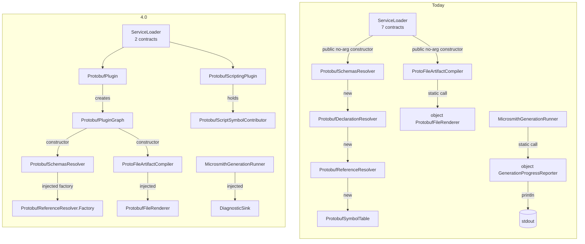

Composition happens in two ways today.

- `gen` uses Metro. `MicrosmithGenerationGraph` is an `internal` graph whose factory takes a `MicrosmithPluginCatalog`. `MicrosmithModel.generate` builds a new graph on every call. `verifyModuleLayers` fails the build if any other module applies Metro (`metroViolations` in `build-logic/.../layers/ModuleLayers.kt`).
- Every other module wires itself by hand. Plugins join through `ServiceLoader` over seven contracts: `discoverMicrosmithPlugins` loads six, and `ScriptSymbolContributorRegistry.discover` loads the seventh. Each implementation needs a public no-argument constructor.

This produces four problems.

### Problem 1: services build their own collaborators

A `ServiceLoader` plugin cannot receive collaborators, so it constructs them.

```kotlin
// resolve-schemas-protobuf: ProtobufSchemasResolver.resolve
val resolver = ProtobufDeclarationResolver(ProtobufReferenceResolver(ProtobufSymbolTable(symbols)))

// resolve-services-dotnet-asp: DotnetAspWorkspaceResolver
class DotnetAspWorkspaceResolver(
    private val dotnetWorkspaceResolver: DotnetWorkspaceResolver = DotnetWorkspaceResolver(),
) {
    private val restResolver = DotnetAspRestResolver()
```

`DotnetWorkspaceResolver()` is built by a default argument in three places: `DotnetWorkspaceDomainResolver`, `DotnetAspWorkspaceResolver` and `DotnetPackageWorkspaceResolver`.

### Problem 2: behaviour lives in `object`s

Main code has 84 top-level `object` declarations. About a dozen are Mappie mappers, which must be objects. Most of the rest are stateless services that a test cannot replace: `ProtobufFileRenderer`, `DotnetAspProjectRenderer`, `DotnetAspPortAllocator`, `GeneratedOutputPathResolver`, `GeneratedOutputUniquenessValidator`, `GenerationProgressReporter`, `ScriptEvaluator`, `ScriptContextFactory`, `PluginClassLoaderScope`.

### Problem 3: I/O, environment, clock and processes are called directly

About 70 of the 724 main source files do this. They cluster at the edges of the system.

| Module group | Files |
|---|---|
| `cli` | 41 |
| `runtime-scripting` | 11 |
| `gradle-plugin` | 6 |
| `gen` | 6 |
| All `resolve-*`, `artifact-*` and `compile-*` modules together | about 6 |

Typical calls:

| Where | Direct call |
|---|---|
| `GenerationProgressReporter` | `println("Generated all files in ...")` |
| `TemporaryDirectory` | `Files.createTempDirectory`, `System.currentTimeMillis()`, `System.err.println` |
| `ScriptHostPaths`, `PluginResolutionPaths` | `System.getenv`, `System.getProperty("user.home")`, `Path.of` |
| `CliDiagnosticEmitter`, `EventLogWriter` | `Instant.now()` |
| `ScriptEvaluator` | `System.nanoTime()` to time `host.eval` |
| `DefaultMicrosmithGradleWorkerProcessExecutor` | `ProcessBuilder(command).start()` |
| `MicrosmithGradleWorkerLauncher` | `System.getProperty("java.home")`, `System.getProperty("os.name")` |

### Problem 4: function parameters stand in for injection

`MicrosmithCli` takes 11 function-typed constructor parameters with defaults, such as `stdout: (String) -> Unit = ::println` and a `scriptRunner` that constructs `MicrosmithScriptHost()`. `RunCommandHandler` repeats the same `scriptRunner` default. The CLI is testable, but its wiring is duplicated and hidden in default arguments.

### The link to #203

#203 makes everything outside the intended API `internal`. Its dry run found 1,391 explicit-API warnings across 38 modules. A sample of 15 split 8 : 4 : 3 into intended API, should-be-internal, and public only because another module or `ServiceLoader` needs it. `BinaryFileArtifactAssembler` is in the last group. Once a plugin graph builds its services, they no longer need to be public. So the two changes decide visibility together.

## Goals and non-goals

| Goals | Non-goals |
|---|---|
| One rule for where logic lives, applied the same way in every module. | Plugins that replace host services, or inject each other's services. |
| Constructor injection for every service, checked at build time within each compilation unit. | A runtime container, reflection-based injection or a service locator. |
| I/O, clock, environment, console and processes behind injected seams that unit tests can replace. | Changing the pipeline stages, or the resolved-model and typed-failure rules in [Architecture principles](../architecture-principles.md). |
| A public plugin API made only of microsmith interfaces, with no Metro types. | A compatibility layer for 3.x plugins. |
| Lifetimes that are safe in long-lived JVMs (Maven, `mvnd`, the IDE) whose plugin classpaths change between builds. | A security sandbox for plugins. See [Trust model](#trust-model). |
| One lifecycle for plugins: a stable id, a fixed order, clear conflict and failure rules, and cleanup when a generation run ends. | Streaming results with `Flow`. The pipeline is a batch transform. |
| Cancellation that reaches generation and child processes. | |
| Visibility and injection decided together, family by family, with #203. | |

## Decision

### Where logic lives

Every operation has exactly one of four homes. Ask these questions in order.

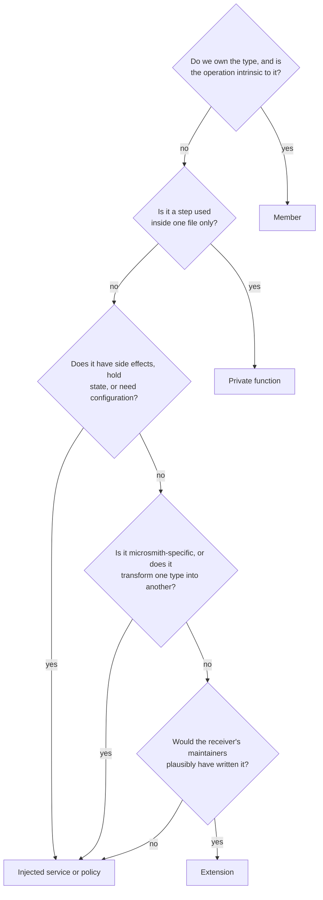

| Home | Use when | Example |
|---|---|---|
| Member | We own the type and the operation is intrinsic to it. | `ResolvedProtobufMessage.of`; `ChangelogExtension.merge` in the [Plugin development](../plugin-development.md) example |
| Extension | A general operation the receiver's maintainers could have written. Never microsmith-specific, except DSL entry points (see [Exceptions](#exceptions-to-the-rules)). Never side-effecting. | `String.toSnakeCase()` |
| Injected service or policy | Microsmith-specific, side-effecting, stateful, configurable, or transforming between types. | Rendering a resolved message as C#; the .NET naming policy; `GeneratedOutputWriter` |
| Private function | A step inside one file. | `requireNoSymlinkTraversal` in `GeneratedOutputPathResolver` |

Four rules follow from the table.

**Rule 1: no `object` with behaviour, except Mappie mappers and script-definition objects.** `object` is still fine for constants, for `data object` values such as `ChangelogArtifactId` in the [Plugin development](../plugin-development.md) example, and for members of sealed hierarchies.

```kotlin
// Before
internal object ProtobufFileRenderer { fun render(artifact: ProtoFileArtifact): String = ... }

// After
@Inject internal class ProtobufFileRenderer { fun render(artifact: ProtoFileArtifact): String = ... }
```

**Rule 2: no service builds another service.** A service lists what it needs in its constructor.

```kotlin
// Before: compile-schemas-protobuf
@ServiceProvider(ArtifactCompiler::class)
class ProtoFileArtifactCompiler : SchemasArtifactCompiler<ProtoFileArtifact> {
    override fun compile(artifact: ProtoFileArtifact) =
        listOf(TextFileArtifactContribution(TextFileArtifactId(artifact.id.relativePath), ProtobufFileRenderer.render(artifact)))
}

// After
@Inject
internal class ProtoFileArtifactCompiler(private val renderer: ProtobufFileRenderer) : SchemasArtifactCompiler<ProtoFileArtifact> {
    override fun compile(artifact: ProtoFileArtifact) =
        listOf(TextFileArtifactContribution(TextFileArtifactId(artifact.id.relativePath), renderer.render(artifact)))
}
```

The compiler becomes `internal`, because the plugin graph builds it instead of `ServiceLoader`.

**Rule 3: values are constructed directly.** Injection is for services. `ResolvedProtobufMessage` and `GeneratedFile` are still built with their constructors or `of` functions.

**Rule 4: use a factory when construction needs both runtime values and services.** See [Factories](#factories).

#### Exceptions to the rules

There are two exceptions. Both are settled questions.

| Exception | Why | What it means |
|---|---|---|
| DSL entry points on scope types are extensions by design, such as `SchemasScope.protobuf` and `RpcScope`'s `String.to`. | A plugin adds vocabulary to a scope it does not own, and an extension is the only way to do that. Replacing them with members or registries is a large redesign outside this change. | The "never microsmith-specific" limit on extensions does not apply to them. |
| Script-definition objects, `MicrosmithScriptCompilationConfiguration` and `MicrosmithScriptEvaluationConfiguration`, may stay `object`s. | Kotlin scripting instantiates them, so they cannot take constructor injection. | They read the script symbol registry from a `ScriptingHostConfiguration` key that the host sets. If the key is absent, as in the IDE, the refiners fall back to discovering `MicrosmithScriptingPlugin` themselves. |

Further examples. Rule 1 and [Factories](#factories) show the other cases.

| Today | 4.0 |
|---|---|
| `internal object DotnetAspPortAllocator` | An injected service. Port allocation is a microsmith-specific policy. |
| `internal fun dotnetAspPascalIdentifier(identifier: String)` | A method on an injected .NET naming policy |
| `artifact.textContribution("Program.cs", ...)` in `compile-services-dotnet-asp` | A private function in the compiler's file, or a member of a contribution-builder service |

### Plugin API

The plugin API has two contracts. `MicrosmithPlugin` is required. `MicrosmithScriptingPlugin` is optional and exists only for plugins that add script symbols. None of the types mentions Metro.

```kotlin
public interface MicrosmithPlugin {
    public val id: String
    public fun services(host: HostServices): PluginServices
}

public interface HostServices {
    public val fileSystem: java.nio.file.FileSystem
    public val clock: Clock
    public val diagnostics: DiagnosticSink
    public val console: Console
    public val environment: Environment
}

public interface PluginServices : AutoCloseable {
    public val domainResolvers: Set<DomainResolver<*, *>> get() = emptySet()
    public val resolutionIssueDiagnosticMappers: Set<ResolutionIssueDiagnosticMapper<*>> get() = emptySet()
    public val artifactContributors: Set<ArtifactContributor<*>> get() = emptySet()
    public val artifactAssemblers: Set<ArtifactAssembler<*>> get() = emptySet()
    public val artifactCompilers: Set<ArtifactCompiler<*>> get() = emptySet()
    public val artifactRenderers: Set<ArtifactRenderer<*>> get() = emptySet()
    override fun close() {}
}
```

The optional contract lives in `runtime-scripting-api`. Its name and shape here are illustrative.

```kotlin
public interface MicrosmithScriptingPlugin {
    public val id: String
    public val scriptSymbolContributors: Set<ScriptSymbolContributor>
}
```

Why scripting is a separate contract:

- Script symbols are needed at script compile time and in the IDE. Both happen before any `generate` call, and in the IDE no script run or generation run exists at all.
- So `MicrosmithScriptingPlugin` takes no `HostServices`. `ScriptSymbolContributor` implementations are pure: they take a declaration site and return values. `ProtobufScriptSymbolContributor`, the only one today, is pure.
- The base plugin API module has no dependency on `runtime-scripting-api`. A plugin that adds no script symbols never sees scripting types.
- A plugin that offers both should use the same `id` for both, so a diagnostic names one plugin.

What `ServiceLoader` finds, and what it needs:

- `ServiceLoader` finds `MicrosmithPlugin` and `MicrosmithScriptingPlugin`. The seven `META-INF/services` files in [Plugin development](../plugin-development.md#6-registration) become one, or two for a plugin with script symbols.
- `ServiceLoader` instantiates the registered provider class. So that class still needs a public no-argument constructor. Plugin jars are loaded from a class path, where `ServiceLoader` accepts nothing else: its static `provider()` alternative applies only to providers declared in a named module. Individual services, such as a resolver or a compiler, no longer need one, because the plugin builds them.
- A plugin may build its services with its own Metro graph, or wire them by hand. The host cannot tell the difference.

A plugin that uses Metro:

```kotlin
@DependencyGraph(ProtobufPluginScope::class)
internal interface ProtobufPluginGraph : PluginServices {
    @DependencyGraph.Factory
    fun interface Factory {
        fun create(@Includes host: HostServices): ProtobufPluginGraph
    }
}

public class ProtobufPlugin : MicrosmithPlugin {
    override val id: String = "io.github.lmliam.microsmith.protobuf"

    override fun services(host: HostServices): PluginServices =
        createGraphFactory<ProtobufPluginGraph.Factory>().create(host)
}
```

The same plugin, with script symbols (illustrative):

```kotlin
public class ProtobufScriptingPlugin : MicrosmithScriptingPlugin {
    override val id: String = "io.github.lmliam.microsmith.protobuf"
    override val scriptSymbolContributors: Set<ScriptSymbolContributor> = setOf(ProtobufScriptSymbolContributor())
}
```

**Why each plugin has a standalone graph.** Metro gathers contributions when it compiles a graph. So a jar loaded at run time cannot contribute to the host graph. A graph extension also cannot be compiled apart from its parent. The [spike](#spike-results) confirms both.

**Limits we accept.**

- A plugin cannot replace a host service.
- Plugins cannot inject each other's services. They meet only through pipeline models: resolved models, artifacts and contributions.

#### Built-in plugins

There is one built-in plugin per module family: protobuf, protobuf RPC, .NET, ASP.NET and .NET packages. Each family's graph builds `DotnetWorkspaceResolver` as a library class, because plugins cannot inject each other's services. This matches the module families and how third parties will ship. Each family already resolves the .NET workspace on its own today.

#### Where the plugin API lives

`PluginServices` names `ArtifactRenderer`, which is in `gen` today. A plugin should not need the engine on its compile classpath. So `ArtifactRenderer` and `GeneratedFile` move down to a layer below `gen`, in the same way that `DomainResolver` lives in `resolve`. `gen` keeps the implementations. The target module must be able to see the relative-path type in `artifact` (see [Paths in pipeline models](#paths-in-pipeline-models)). Slice 0 picks it.

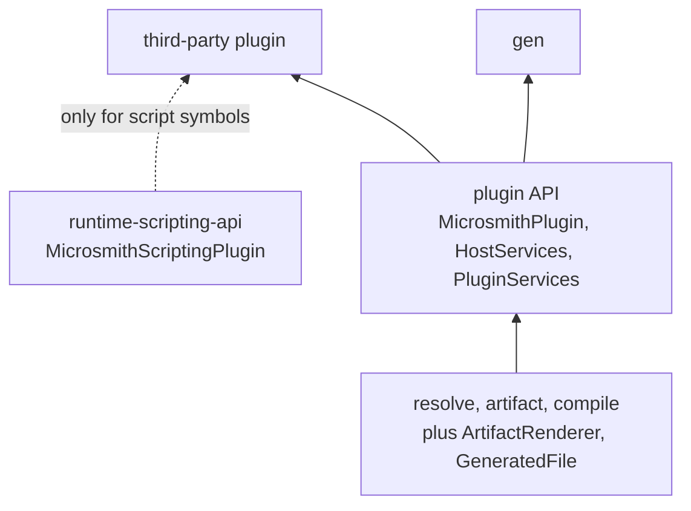

Arrows point from a dependency to the module that uses it.

#### `HostServices` is a per-plugin view

The host builds a new `HostServices` for each plugin in each generation run. The five members come from two places.

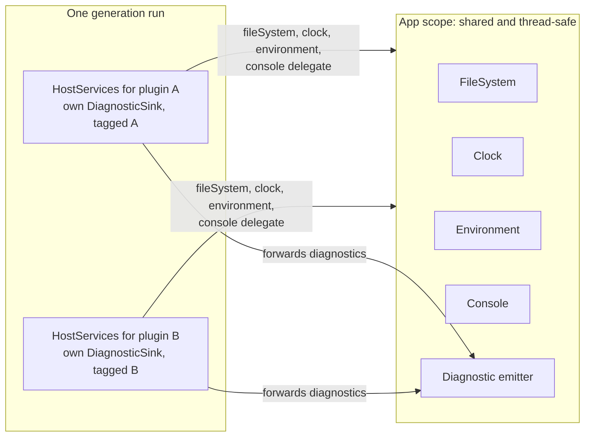

| Member | What the plugin gets |
|---|---|
| `fileSystem`, `clock`, `environment`, `console` | A delegate to the app-scoped implementation. |
| `diagnostics` | A sink scoped to the generation run. It tags every diagnostic with the plugin id and forwards it to the app-level emitter. |

**Concurrency rule.** Maven can run several generation runs at once in one JVM. So every app-scoped seam implementation must be thread-safe. `Console` writes must be atomic per line or message. Today `CliDiagnosticEmitter` has no mutable state and no synchronisation around its sinks, and `GenerationProgressReporter` is a stateless `object` that calls `println`. Progress state, buffers and diagnostic context are generation-run state. They never live in an app singleton.

#### Metro across the plugin boundary

No Metro type crosses the boundary, so a plugin may use Metro or not. But a plugin that uses Metro carries a coupling that the plugin API cannot hide.

| Plugin kind | Which Metro runtime runs | What follows |
|---|---|---|
| Built-in | The host's. It is compiled with the host. | Always matches. |
| Third-party, uses Metro | The host's. Plugin class loaders are parent-first, so a Metro runtime bundled unrelocated in the plugin jar is ignored. | Works only against the exact Metro version the host ships. |
| Third-party, hand-wired | None. | No coupling. |

Metro does not guarantee that generated code is compatible with a runtime version other than the one it was compiled against (see [Metro's stability page](https://zacsweers.github.io/metro/latest/stability)). So a microsmith release that bumps Metro can break a third-party Metro plugin without any change to the microsmith plugin API. A mismatch shows up as a `LinkageError` inside `services(host)`. The host reports it as described in [Plugin identity, ordering, conflicts and failure](#plugin-identity-ordering-conflicts-and-failure). The policy for third-party plugins is [open question 14](#14-metro-policy-for-third-party-plugins).

### Host composition

The host has three levels. The app graph and the generation run graph are Metro graphs in `gen`. The script run lives in `runtime-scripting`.

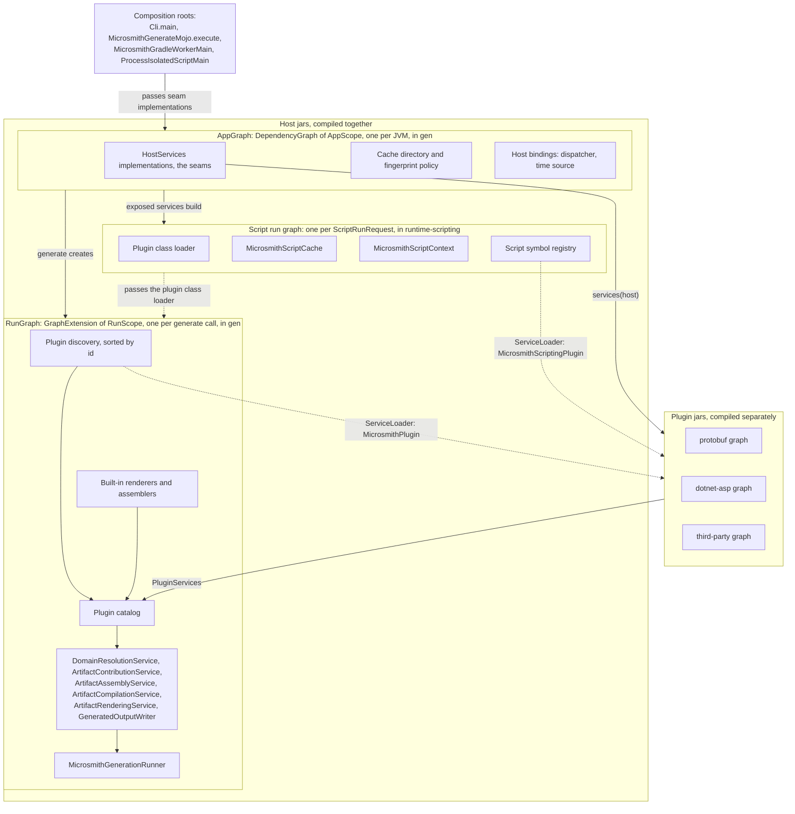

- **`AppGraph`** replaces `MicrosmithGenerationGraph`. The composition roots create it: `Cli.main`, `MicrosmithGradleWorkerMain`, `ProcessIsolatedScriptMain` and `MicrosmithGenerateMojo.execute`. It holds only immutable, class-loader-independent state.
- **The script run** is built in `runtime-scripting`, from the services that the app graph exposes. It owns the plugin class loader. It exists before compilation, so the script compile cache is available to the compiler.
- **`RunGraph`** is a `@GraphExtension(RunScope::class)` of `AppGraph`. Its factory takes the plugin class loader. It discovers `MicrosmithPlugin` implementations, sorts them by id, calls `services(host)` on each, and merges the results into the catalog.
- **A generation run does not need a script run.** `gen` must stay usable without scripting. A programmatic `generate` call with no script uses the caller's class loader.
- **Built-ins are bound, not discovered.** `RunGraph` binds `TextFileArtifactRenderer`, `BinaryFileArtifactRenderer`, `TextFileArtifactAssembler` and `BinaryFileArtifactAssembler` directly.
- **The layer rule changes.** "Metro only in gen" is replaced by two rules:
  1. No published API module (`dsl`, `resolve`, `artifact`, `compile`, the plugin API module, `runtime-scripting-api`) exposes a Metro type in its ABI. The ABI dumps from #207, which ship in 3.0.0, can check this.
  2. Metro scope markers used on both sides of the boundary live in the plugin API module.

**One constraint.** Metro aggregates bindings when the module that declares a graph compiles. So `gen`'s graph cannot see bindings declared in `runtime-scripting` or `cli`. Two things follow.

1. The composition root passes seam implementations into the app graph's factory. For example, the CLI passes its `Console`.
2. The script run graph in `runtime-scripting` is built from the app graph's exposed services. It is not a child of the app graph in `gen`.

Slice 0 confirms whether the script run graph is a graph extension or an `@Includes` graph.

### One `generate` call

A script run may contain several of these. A programmatic caller has no script run and calls `generate` directly.

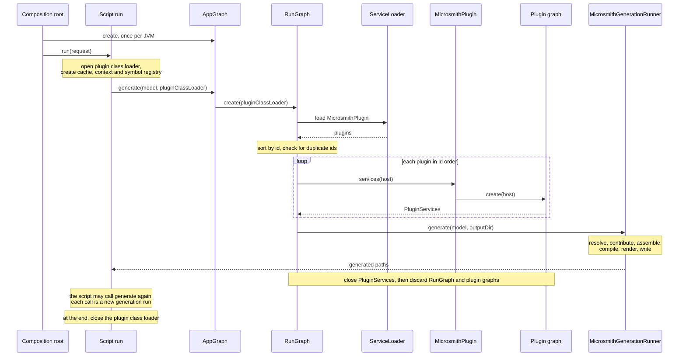

### Lifetimes

There are three named lifetimes, and they nest in time. A fourth, transient, is the default for everything else.

| Lifetime | Scope | Holds | Rule |
|---|---|---|---|
| App singleton | `AppScope` | Seam implementations, cache directory, fingerprint policy, host bindings | Immutable state only, and nothing that depends on the plugin class loader. Nothing to close. |
| Script run | A graph in `runtime-scripting` | Plugin class loader, `MicrosmithScriptCache`, script context, script symbol registry | One `ScriptRunRequest`. Exists before compilation. Closes the class loader after its last generation run closes. |
| Generation run | `RunScope`, and each plugin graph's own scope | `RunGraph`, plugin graphs, pipeline services, run-scoped diagnostics state | One `generate` or `emit` call. A plugin's `@SingleIn` means once per generation run. |
| Transient | none | Most services | A new instance per injection. The default. |

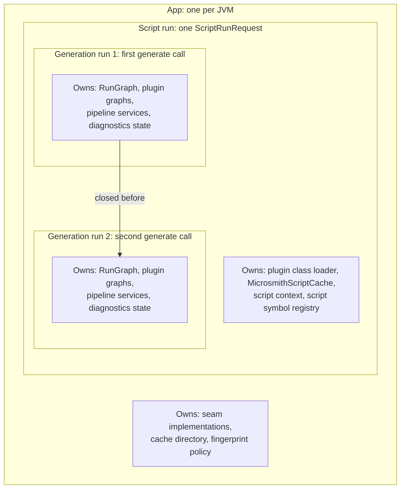

The levels nest in time, not in the graph. `RunGraph` is created from the app graph by `generate`. The script run owns the plugin class loader and passes it to each generation run.

**Why the script run is its own lifetime.** `ClassloaderScriptRunner.execute` runs once per `ScriptRunRequest`. In that one call it does these things in order.

1. It opens the plugin class loader (`PluginClassLoaderScope`: a `URLClassLoader` that `use` closes when the block returns, or the host's own class loader when the request has no plugin classpath).
2. It constructs `MicrosmithScriptCache`.
3. It creates the script context (`ScriptContextFactory.create`).
4. It compiles and evaluates the script.

The Kotlin scripting host reads and writes the cache during `host.eval`. That happens before, and independent of, any `generate` call. `generate` never touches the cache. So the cache cannot be generation-run state. A script can call `emit` or `generate` more than once, because `MicrosmithScriptContext.emit` accumulates `generatedRoots`. Each call is its own generation run. A script that calls `generate` three times gets three generation runs inside one script run.

The spike observed this across two generation runs in one JVM:

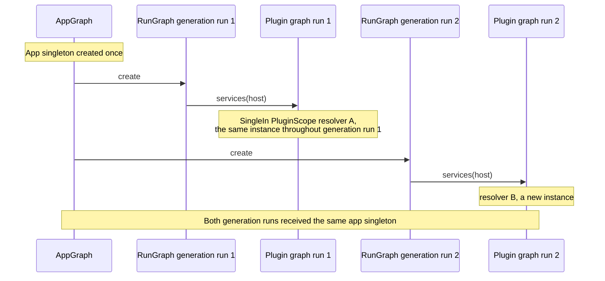

**Why app singletons are restricted.** One JVM can run many builds with different plugin classpaths. An app singleton that held a plugin class would leak its class loader and could hand a stale class to the next build.

Where a JVM is reused today:

| Host | Where generation runs | Consequence |
|---|---|---|
| Maven | In the build JVM. `MicrosmithGenerateMojo` is `threadSafe = true`. | A parallel build can run several generation runs at once, so every app-scoped seam must be thread-safe. |
| IDE | The IDE process loads `MicrosmithScriptCompilationConfiguration`, whose refiner calls `ScriptSymbolContributorRegistry.discover()`. | Plugin code runs in a long-lived JVM. No script run or generation run exists, so the refiners discover `MicrosmithScriptingPlugin` themselves. |
| Gradle | In a new JVM for every task execution, started by `MicrosmithGradleWorkerLauncher`. | Not the case that drives the rule, but the rule still holds. |

A lifetime says how long an object lives. It does not say how its resources are released. That is covered in [Lifecycle and disposal](#lifecycle-and-disposal).

### I/O seams

Each seam is its own interface on `HostServices`. There are five.

| Seam | Replaces | Main users today |
|---|---|---|
| `java.nio.file.FileSystem` | `Path.of`, `Paths.get`, and the default file system behind `Files.*` | `gen` output writing, `cli` plugin cache and lockfiles, `ScriptHostPaths` |
| `Clock` (`kotlin.time.Clock`) | `Instant.now()`, `System.currentTimeMillis()` | `CliDiagnosticEmitter`, `EventLogWriter`, `TemporaryDirectory` |
| `DiagnosticSink` | Ad hoc warnings and progress on stdout or stderr | `GenerationProgressReporter`, `TemporaryDirectory.close` |
| `Console` | `println`, `System.err.println`, and `MicrosmithCli`'s `stdout` and `stderr` lambdas | `cli`, `ProcessIsolatedScriptMain`, `MicrosmithGradleWorkerMain` |
| `Environment` | `System.getenv`, `System.getProperty` | `ScriptHostPaths`, `PluginResolutionPaths`, `DoctorPaths`, `RepositoryAllowlistPolicy`, `DefaultRepositoryCredentialsResolver`, `MicrosmithGradleWorkerLauncher` |

Three more bindings exist, but they are host-only. They are not on `HostServices` in 4.0.

| Host binding | Replaces | Main users today |
|---|---|---|
| `TimeSource` (`kotlin.time.TimeSource`) | `System.nanoTime()` | `ScriptEvaluator` |
| Coroutine dispatcher | The `Dispatchers.IO` default argument on `GeneratedOutputWriter`, `TemporaryDirectory.create` and `generateTo` | The generation pipeline |
| `ProcessLauncher` (`suspend`) | `ProcessBuilder` | `DefaultMicrosmithGradleWorkerProcessExecutor`, `JvmProcessIsolationWorkerLauncher` |

**Why these three stay host-only.** `HostServices` is implemented by the host and consumed by plugins. So a member can be added later without breaking plugins, but removing one is a break. A member that plugins have no need for should not be added until one does. No plugin launches a process today: both users of `ProcessBuilder` are host code. `ProcessLauncher` is also `suspend`, and no function in the plugin API is, so a plugin could not call it.

```kotlin
// Before: ScriptHostPaths
val envPath = System.getenv("MICROSMITH_SCRIPT_CACHE_DIR")?.trim()?.takeIf { it.isNotEmpty() }
return Path.of(System.getProperty("user.home"), ".microsmith", "cache", "scripts")

// After (Environment method names are illustrative)
val envPath = environment.variable("MICROSMITH_SCRIPT_CACHE_DIR")?.trim()?.takeIf { it.isNotEmpty() }
return fileSystem.getPath(environment.property("user.home"), ".microsmith", "cache", "scripts")
```

`Path.of` and `Paths.get` are banned in main code in favour of `fileSystem.getPath`. A build check enforces the ban.

Some APIs accept only the default file system: Kotlin scripting (`FileScriptSource`, `CompiledScriptJarsCache`, and `updateClasspath`, which take `java.io.File`) and `URLClassLoader`. Code that calls them stays on the default file system, and integration tests cover it.

#### Time: two seams

Time has two jobs, and each gets its own type.

| Job | Type | Production | Tests |
|---|---|---|---|
| "What time is it?" A timestamp in an event or a name. | `kotlin.time.Clock`, stable since Kotlin 2.3. The build uses 2.4.21. | `Clock.System` | A fixed or controllable clock |
| "How long did it take?" A duration. | `kotlin.time.TimeSource` | `TimeSource.Monotonic` | `TestTimeSource` |

A wall clock must not measure durations, because it can jump when the system clock changes. `System.nanoTime()` in `ScriptEvaluator` is the only duration measurement today, and its value is reported, never used for control flow.

```kotlin
// Before: ScriptEvaluator
val startNanos = System.nanoTime()
val result = host.eval(...)
val elapsedMillis = (System.nanoTime() - startNanos) / NANOS_PER_MILLISECOND

// After (illustrative)
val mark = timeSource.markNow()
val result = host.eval(...)
val elapsed = mark.elapsedNow()
```

`kotlin.time.Clock` also settles [question 9](#settled-questions): it replaces `Instant.now()` and `System.currentTimeMillis()`.

#### Paths in pipeline models

Pipeline models hold `java.nio.file.Path` in six types today. The first three also carry a relative path.

| Type | Module | Members that hold a `Path` |
|---|---|---|
| `TextFileArtifactId` | `artifact` | `relativePath`, `outputRoot` |
| `BinaryFileArtifactId` | `artifact` | `relativePath`, `outputRoot` |
| `GeneratedFile` | `gen` | `relativePath`, `outputRoot` (default `Path.of(".")`) |
| `ResolvedDotnetAspService` | `resolve-services-dotnet-asp` | `outputRoot` |
| `DotnetAspServiceArtifact` | `artifact-services-dotnet-asp` | `outputRoot` |
| `DotnetAspServiceContribution` | `artifact-services-dotnet-asp` | `outputRoot` |

Pure modules build these paths with `Path.of`: `ProtoFileArtifactId`, `MsBuildProjectArtifactCompiler` and `DotnetAspProjectFileSupport`. They have no `FileSystem`. A default-file-system `Path` cannot be resolved against a Jimfs root (`ProviderMismatchException`). The `Path.of` ban would also leave these modules no way to build a path.

The decision: pipeline models carry a file-system-independent relative-path value type, defined in `artifact`. `outputRoot` becomes the same logical type. `GeneratedOutputWriter` resolves both against the injected `FileSystem` at the write boundary.

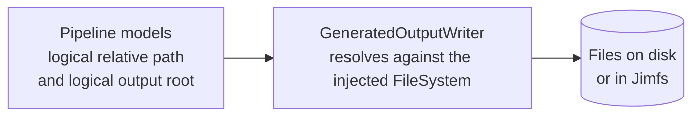

```kotlin
// Before
TextFileArtifactId(Path.of("schemas", "orders.proto"))

// After (the type name is illustrative)
TextFileArtifactId(RelativePath.of("schemas", "orders.proto"))
```

This is a 4.0 breaking change to the six types above. The infix `Path.to(contents)` helper in `GeneratedFile.kt` changes its receiver with them. 4.0 already breaks the plugin API, and pipeline models should not depend on a file system.

### Factories

Use assisted injection when a service needs a value known only at call time as well as injected services.

```kotlin
// Before: ProtobufSchemasResolver.resolve
val resolver = ProtobufDeclarationResolver(ProtobufReferenceResolver(ProtobufSymbolTable(symbols)))

// After
@AssistedInject
internal class ProtobufReferenceResolver(
    @Assisted private val symbols: ProtobufSymbolTable,
    private val naming: ProtobufNamingPolicy,
) {
    @AssistedFactory
    fun interface Factory {
        fun create(symbols: ProtobufSymbolTable): ProtobufReferenceResolver
    }
}
```

Candidates in today's code:

| Type | Value known at call time | Injected services | Built once per |
|---|---|---|---|
| `ProtobufReferenceResolver`, `ProtobufDeclarationResolver` | The symbol table built in `ProtobufSchemasResolver.resolve` | Naming and validation policies | Call |
| `TemporaryDirectory` (today `TemporaryDirectory.create`) | A prefix | File system, clock | Generation run |
| `MicrosmithScriptCache` | The cache directory and the plugin classpath fingerprint | File system | Script run |
| `MicrosmithScriptContext` (today `ScriptContextFactory.create`) | The output path and the request | The generation entry point | Script run |

Do not use a factory for a value. `DirectorySpace.from(path)` builds a value but also calls `Files.createDirectories`. The side effect moves into a service, and `DirectorySpace` keeps a plain constructor.

### Testing

| Layer | File system | Clock, time source, process, environment |
|---|---|---|
| Unit | May inject an in-memory file system (Jimfs) through the injected `FileSystem`. | Injected fakes, such as `TestTimeSource`. |
| Integration and end-to-end | Real temporary directories, to catch real permissions, symbolic links and OS paths. For example, `GeneratedOutputPathResolver`'s symbolic-link checks need a real file system. | Real, unless the test is about them. |

Tests use a plugin's real graph or hand-wired real collaborators. They do not use a test container. Tests of `suspend` code use `runTest` with a test dispatcher bound in place of the host's dispatcher (see [Coroutines and `suspend`](#coroutines-and-suspend)). The acceptance tests that slice 0 adds are listed under [Acceptance tests for slice 0](#acceptance-tests-for-slice-0).

Changes to `AGENTS.md`:

| Line today | Becomes |
|---|---|
| Unit layer row: "A temporary directory is allowed when the unit writes files." | "An in-memory file system is allowed when the unit reads or writes files." |
| "Use a test double only at a boundary: network, file system, clock." | "Use a test double only at a boundary: network, file system, clock, process, environment." |
| "Use a temporary directory instead of a fake file system." | "In unit tests, use an in-memory file system through the injected `FileSystem`. In integration and end-to-end tests, use a real temporary directory." |

### Plugin identity, ordering, conflicts and failure

#### Identity

`MicrosmithPlugin` has a `public val id: String`. The id is stable, unique and reverse-DNS style, such as `io.github.lmliam.microsmith.protobuf`. The host uses it to sort plugins and to name them in diagnostics.

#### Order

The host sorts discovered plugins by `id` before it calls `services`. Generated output must never depend on `ServiceLoader` order, class path order or `Set` iteration order.

Today `discoverMicrosmithPlugins` keeps the `ServiceLoader` iteration order. The output is still stable, because the stages that follow sort. 4.0 keeps all of this and adds the sort by id.

| Component | What it sorts |
|---|---|
| `DomainResolverRegistry`, `DomainResolutionService` | Resolvers, by resolved type and class name |
| `ArtifactContributorRegistry`, `ArtifactContributionService` | Contributors and their results |
| `ResolutionIssueDiagnosticMapperRegistry` | Mappers |
| `ScriptSymbolContributorRegistry` | Contributors, by id |
| `MicrosmithGenerationRunner` | Output roots |
| Host, new in 4.0 | Plugins, by id, before `services(host)` |

Slice 0 adds a test that shuffles the discovery order and expects byte-identical output.

#### Conflicts

When two plugins collide, the generation run fails with an error that names both plugin ids. The host records which plugin supplied each service, so it can do this.

| Situation | What happens |
|---|---|
| Two plugins have the same `id` | The generation run fails. |
| Two compilers, assemblers or renderers claim one artifact type | The generation run fails. This is today's rule: `ArtifactCompilerRegistry`, `ArtifactAssemblerRegistry` and `ArtifactRendererRegistry` fail at construction. |
| Several resolvers for one authoring type | All run, in sorted order. This is today's rule. `DomainResolverRegistry` rejects only the same class registered twice for one type. |
| Several contributions to one artifact id | The assembler merges them. The text and binary assemblers accept identical content and reject differing content. This is today's rule. |
| Two outputs with the same path | The generation run fails. This is today's rule: `GeneratedOutputUniquenessValidator` rejects two outputs with the same normalised root and path. |

#### Failure

If discovery of a plugin, or its `services(host)` call, throws, the whole generation run fails before the pipeline starts. This includes `ServiceConfigurationError` and `LinkageError`.

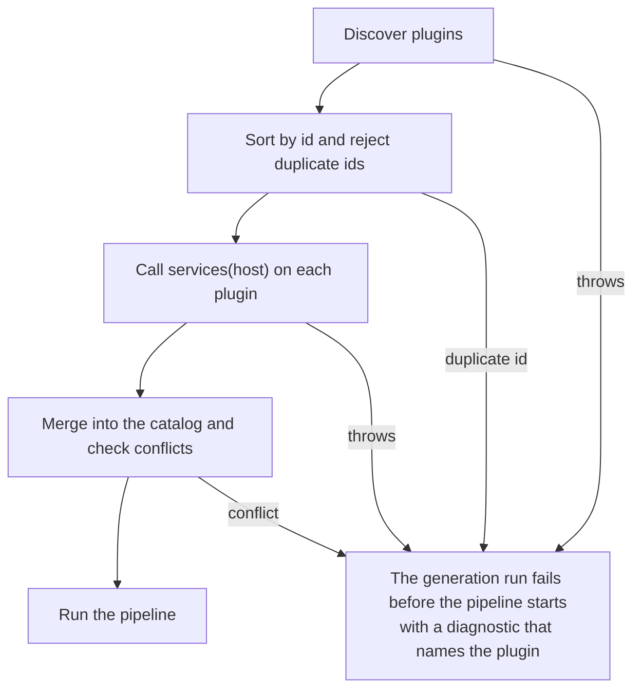

The diagnostic names the plugin id when it is known. Otherwise it names the provider class and the jar. There is no partial loading. Silently skipping a plugin would silently change the output.

Today `loadServices` does not catch anything. A broken plugin surfaces as a `ServiceConfigurationError`, reported as "Unhandled script host failure: ..." or "Failed to load runtime service providers: ...". Nothing guarantees that the message names the plugin.

#### Compatibility expectation

The plugin API follows semver, and the ABI dumps from #207 check it. A plugin built against 4.x runs on any later 4.y. A `LinkageError` at the boundary is reported as an incompatible plugin, not as a raw stack trace. A plugin that uses Metro has a stricter limit: see [Metro across the plugin boundary](#metro-across-the-plugin-boundary).

### Coroutines and `suspend`

#### Coroutines today

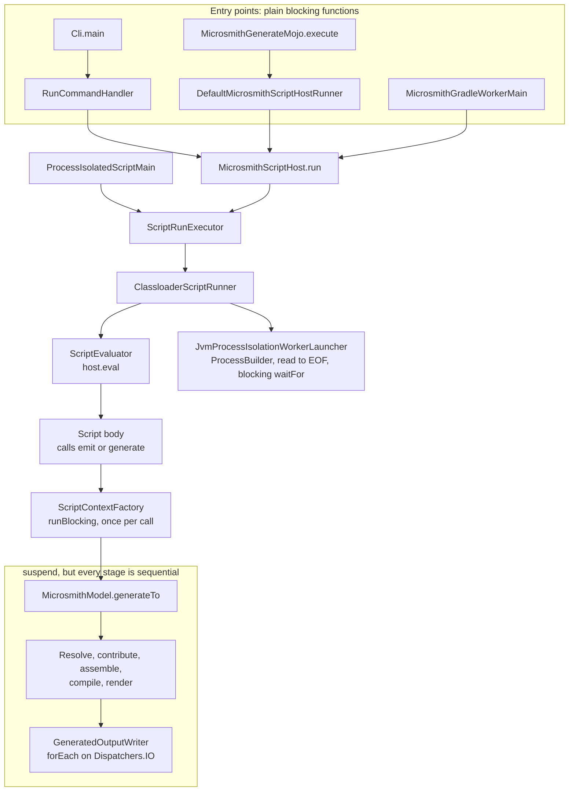

What this shows:

- `MicrosmithGenerationRunner.generate`, `MicrosmithModel.generate` and `generateTo`, `TemporaryDirectory.create` and `GeneratedOutputWriter.write` are `suspend`. `generateTo`, `TemporaryDirectory.create` and `GeneratedOutputWriter.write` each call `withContext(Dispatchers.IO)`.
- The only `runBlocking` in main code is in `ScriptContextFactory`: `runBlocking { model.generateTo(outputPath) }`. It runs on the script's thread, once per `emit` or `generate` call. Everything above it is blocking.
- There is no `async`, `launch`, `coroutineScope` or `Flow` in main code. Every pipeline stage is sequential: `DomainResolutionService`, `ArtifactContributionService`, `ArtifactAssemblyService`, `ArtifactCompilationService`, `ArtifactRenderingService`, and `GeneratedOutputWriter`, which does a sequential `forEach` on the I/O dispatcher.
- `JvmProcessIsolationWorkerLauncher` and `DefaultMicrosmithGradleWorkerProcessExecutor` start a `ProcessBuilder`, read stdout to the end, then call a blocking `waitFor()`. There is no timeout, no `destroy` and no cancellation.
- None of the seven plugin contracts is `suspend`.

**The honest finding.** Today `suspend` only moves I/O to another thread. There is no concurrency. There is no way to cancel a process. The dispatcher is chosen by a default argument.

#### Options

| Option | What changes | For | Against |
|---|---|---|---|
| a. Keep as is, and move the dispatcher to a host binding | Only where the dispatcher comes from. | Smallest change. | Keeps blocking entry points, uncancellable processes and no concurrency. `suspend` stays a thread switch. |
| b. Structured concurrency in the host. Plugin contracts stay blocking. | The host API is `suspend` from each composition root down. Processes are cancellable. Independent I/O runs in parallel. | Cancellation and timeouts work. Plugins are unaffected. The cost lands in the host, where one team owns it. | Slices 4 and 5 touch many call sites. The host has thread-safety obligations. |
| c. `suspend` everywhere, including the plugin API | As b, plus every plugin API function becomes `suspend`. | Plugins could await I/O. | Every contract is a pure CPU transform today. `suspend` would colour every plugin and add nothing. It is a breaking change for every plugin author. |

#### Decision: option b

1. **The host API is `suspend` from the composition roots down.** `MicrosmithScriptHost.run` and the chain beneath it become `suspend`. Each composition root holds exactly one `runBlocking`: `Cli.main`, `MicrosmithGenerateMojo.execute`, `MicrosmithGradleWorkerMain` and `ProcessIsolatedScriptMain`.
2. **One bridge remains inside.** A Kotlin script body is not `suspend`, so `MicrosmithScriptContext.generate` and `emit` must block. The bridge runs the generation as a child of the script run's `Job`. Cancelling the script run then cancels the generation.

   ```kotlin
   // Before: ScriptContextFactory
   { model -> runBlocking { model.generateTo(outputPath) } }

   // After (illustrative)
   { model -> runBlocking(scriptRunJob) { model.generateTo(outputPath) } }
   ```

   The hazard: a bare nested `runBlocking` is not a child of anything, so cancellation would never reach it. The script body itself cannot be interrupted. A cancelled script stops at its next `emit` or `generate` call. The script runs on the I/O dispatcher, so a blocking script never occupies the root's event loop. Slice 4 confirms this threading.
3. **`ProcessLauncher` is a `suspend` host binding.** Awaiting a process is cancellable. Cancellation destroys the process. Callers can apply `withTimeout`. This fixes today's blocking `waitFor()` with no timeout.

   ```kotlin
   // Before: JvmProcessIsolationWorkerLauncher.execute
   val process = ProcessBuilder(buildCommand(requestFile, resultFile)).redirectErrorStream(true).start()
   val processOutput = process.inputStream.bufferedReader().use { it.readText().trim() }
   val exitCode = process.waitFor()

   // After (illustrative)
   public interface ProcessLauncher {
       public suspend fun run(command: List<String>): ProcessResult
   }

   // The caller sets a time limit. Cancelling the call destroys the process.
   val result = withTimeout(10.minutes) { processLauncher.run(command) }
   ```
4. **The plugin API stays non-`suspend` in 4.0.** Every service interface is a pure CPU transform, and `services(host)` only builds objects. `suspend` would colour every plugin and add nothing. The host checks for cancellation between units of work: between domains, between artifacts and between files.
5. **The dispatcher is a host binding** (settled question 8). Choosing a dispatcher is separate from being `suspend`. Code is `suspend` where it awaits something or must be cancellable. It is not `suspend` merely to reach `Dispatchers.IO`.
6. **Parallelism is used only where items are independent.** The order of results is fixed by collecting them in input order. Writing files comes first, because it is I/O bound and `GeneratedOutputUniquenessValidator` has already guaranteed that no two outputs share a path. Rendering runs in parallel in slice 0 if [open question 12](#12-concurrent-calls-into-one-plugins-services) is answered b, so that the contract is tested from the start. Compiling follows only if a benchmark on a large model shows a gain. There is no `Flow`: the pipeline is a batch transform, not a stream.
7. **`FileSystem` stays the blocking `java.nio` API.** Host code that does file I/O wraps it on the I/O dispatcher.

#### Coroutines in 4.0

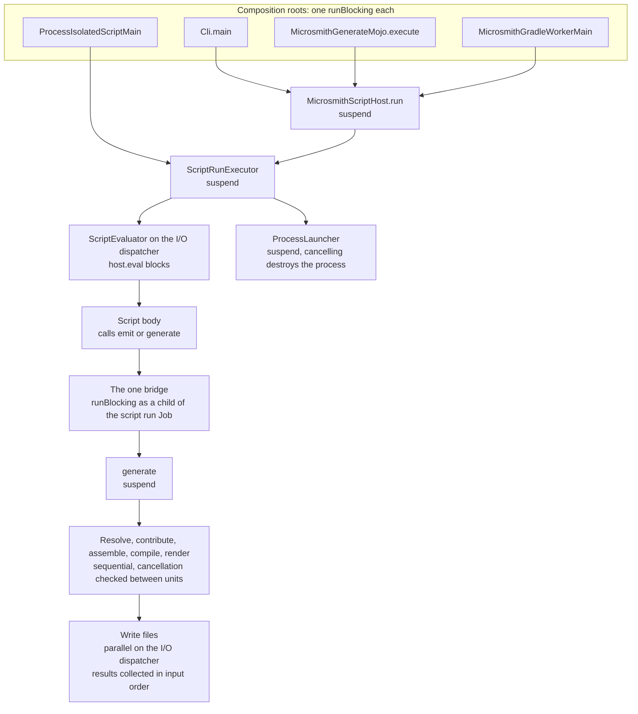

#### What this costs

- **Thread-safety obligations.** The host runs file writes in parallel and Maven runs generations in parallel. Whether plugin services may also be called concurrently is [open question 12](#12-concurrent-calls-into-one-plugins-services).
- **Tests.** Tests of `suspend` code need `runTest` with a test dispatcher bound in place of the host's dispatcher.
- **The class loader.** Today `defaultPluginClassLoader()` reads the thread context class loader, which belongs to one thread. Work that moves to another dispatcher can see a different one. The generation run takes the plugin class loader explicitly, as [Host composition](#host-composition) says.

### Lifecycle and disposal

A scope says how long an object lives. It does not say how its resources are released. So a generation run has an explicit lifecycle.

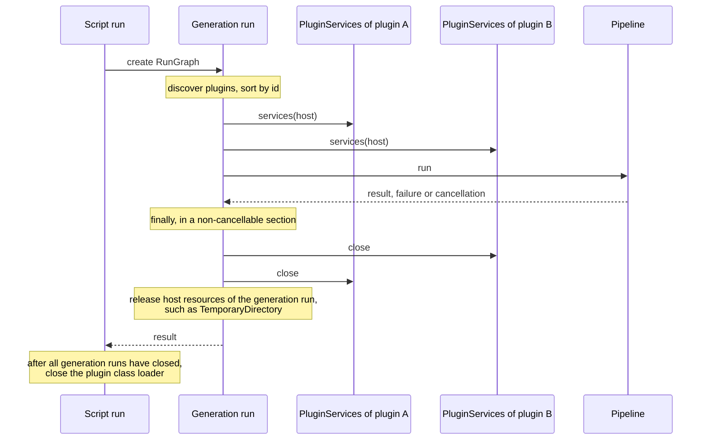

`PluginServices` extends `AutoCloseable` with a default `close()` that does nothing. A plugin that owns a resource overrides it (illustrative):

```kotlin
internal class IndexedPluginServices(private val index: OpenIndex) : PluginServices {
    override val artifactCompilers: Set<ArtifactCompiler<*>> = setOf(IndexedCompiler(index))

    override fun close() = index.close()
}
```

**Guarantees.**

| Guarantee | Detail |
|---|---|
| `close` always runs | It runs in a `finally`, also when the pipeline throws or is cancelled, in a non-cancellable section. |
| Reverse order | Each plugin's `PluginServices` closes in the reverse of the order that `services(host)` ran. |
| A failing `close` does not hide the original failure | It is reported as a warning diagnostic that names the plugin. When the generation run already failed, it is also added as a suppressed exception to that failure. |
| A failing `close` does not stop the others | The remaining plugins still close. |
| Class loader last | The script run closes the plugin class loader after all its generation runs have closed. |

**Guidance for plugin authors.** Plugin services should be stateless transforms. They should not hold executors, watchers or connections. Nothing a plugin creates may outlive its generation run. That is also what keeps the plugin class loader collectable.

**The app graph has nothing to close.** It holds no resources, by the rule in [Lifetimes](#lifetimes).

## Alternatives considered

| Option | For | Against | Verdict |
|---|---|---|---|
| **Koin** | Its runtime modules are the closest match to ASP.NET's `IServiceCollection`. A runtime container can take contributions from jars loaded later. | Koin types would enter the public plugin API. Missing bindings surface at run time. Koin Annotations is moving to a compiler plugin, which adds the same Kotlin-version coupling as Metro. | Rejected |
| **kotlin-inject** | Checks graphs at compile time. | No runtime aggregation either, so the plugin boundary stays the same. Adds a KSP step to every module. Metro covers the same ground and is already in the build. | Rejected |
| **Custom container** | A runtime registry keyed by type would let plugins contribute to the host. | Gives up build-time checking in every module. Microsmith would have to maintain it. | Rejected |
| **Inject everything** | One uniform mechanism. | Extensions, private helpers and value construction would go through the graph. More wiring with no easier testing, because pure functions are already testable directly. | Rejected |
| **Status quo** | Works today. | Keeps public no-argument constructors as an API requirement, against #203. Keeps I/O untestable outside `cli`. Leaves inline construction in place. | Rejected |

## Trust model

Plugins are trusted code. They run in the host JVM with the host's privileges.

`HostServices` is a testability seam. It is not a capability boundary, and it is not a sandbox. A plugin can call `java.io` directly and bypass every seam.

The controls are on what gets loaded.


| Control | Class | What it enforces |
|---|---|---|
| Repository allowlist | `RepositoryAllowlistPolicy` | Third-party plugin jars reach the classpath through `PluginResolutionService`. A repository must pass the allowlist: Maven Central, plus `MICROSMITH_REPOSITORY_ALLOWLIST`. `file://` repositories are allowed only with `MICROSMITH_ALLOW_FILE_REPOSITORIES=true`. |
| Checksum verification | `PluginResolutionIntegrityVerifier` | Checks each resolved jar's checksum against the lockfile. |

A real sandbox would need process isolation and an RPC boundary. That is out of scope, and it is a non-goal.

## Consequences and risks

| Risk | Detail |
|---|---|
| Compiler-plugin coupling | Metro is a Kotlin compiler plugin, and each Metro release supports a narrow range of Kotlin versions. Today only `gen` is coupled. After this change, every module that uses Metro, and every third-party plugin that chooses to, must upgrade Kotlin and Metro together. A hand-wired plugin has no such coupling. |
| Metro runtime across the plugin boundary | A third-party plugin that uses Metro works only against the exact Metro version the host ships, so a microsmith release that bumps Metro can break it with no change to the plugin API. A hand-wired plugin has no such coupling. See [Metro across the plugin boundary](#metro-across-the-plugin-boundary) and [open question 14](#14-metro-policy-for-third-party-plugins). |
| Every third-party plugin must migrate | The seven `META-INF/services` registrations become one `MicrosmithPlugin`, plus a `MicrosmithScriptingPlugin` if the plugin adds script symbols, and every plugin gains an `id`. This is a 4.0 breaking change. The release notes need a migration section, and [Plugin development](../plugin-development.md) needs a rewrite. |
| Two kinds of checking | Metro checks a plugin's graph when the plugin compiles. The boundary between host and plugin is checked at run time: a missing or failing `MicrosmithPlugin` shows up only when a generation run discovers it. The boundary is deliberately small: two entry interfaces that each carry an `id` and one member that hands over plugin content, plus `HostServices` and `PluginServices`. |
| Concurrency obligations | Parallel Maven builds and parallel file writes need thread-safe seams. If [open question 12](#12-concurrent-calls-into-one-plugins-services) is answered b, every plugin author also takes on that obligation. |
| Size | About 724 main files across 38 published modules, plus #203's 1,391 explicit-API warnings. Splitting by module family keeps each pull request reviewable. |
| Host API becomes `suspend` | The script host, the CLI, the Gradle worker and the Maven mojo all change signature. Slices 4 and 5 carry this. |

## Migration plan

Each slice decides injection and visibility for its modules together.

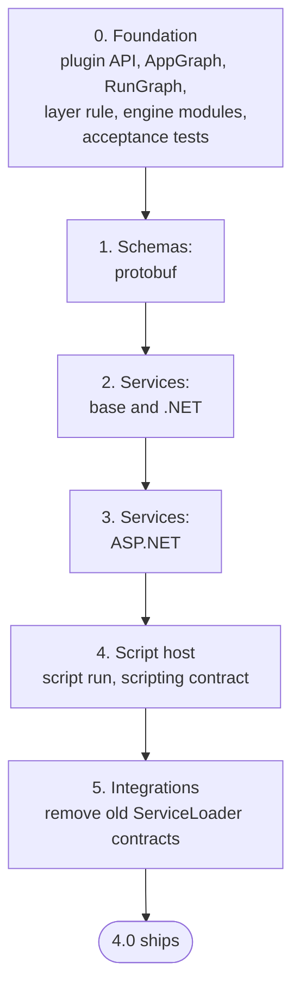

| # | Slice | Modules | Main files | #203 warnings | Direct-I/O files |
|---|---|---|---|---|---|
| 0 | Foundation | Plugin API module (`MicrosmithPlugin`, `HostServices`, `PluginServices`, seam interfaces); `AppGraph` and `RunGraph` in `gen`; replacement layer rule and `Path.of` check; `dsl`, `resolve`, `artifact`, `compile`, `gen` | 65 | 127+ (`dsl` 34, `artifact` 37, `gen` 34, `resolve` 22; `compile` not reported separately) | 6, in `gen` |
| 1 | Schemas: protobuf | `schemas/base`, `schemas/protobuf`, `schemas/protobuf-rpc` | 175 | `dsl-schemas-protobuf` 213, `resolve-schemas-protobuf` 145 | few |
| 2 | Services: base and .NET | `services/base`, `services/dotnet`, `services/dotnet-packages` | 120 | `dsl-services-dotnet` 226, `compile-services-dotnet` 158, `dsl-services` 58 | few |
| 3 | Services: ASP.NET | `services/dotnet-asp` | 119 | `dsl-services-dotnet-asp` 80, `resolve-services-dotnet-asp` 73 | few |
| 4 | Script host | `runtime-scripting`, `runtime-scripting-api` | 62 | 44 | 11 |
| 5 | Integrations | `cli`, `gradle-plugin`, `maven-plugin` | 183 | 23 | 47 |

What each slice adds beyond injection and visibility:

| # | Added work |
|---|---|
| 0 | Plugin `id`, sort by id, duplicate and conflict errors that name both plugin ids, and the failure rules. `PluginServices` as `AutoCloseable`, and the generation-run lifecycle. The per-plugin `HostServices` view with its tagged `DiagnosticSink`. The file-system-independent path type and the moves of `ArtifactRenderer` and `GeneratedFile`. `kotlin.time.Clock`. The `suspend` `ProcessLauncher` interface and the dispatcher as a host binding. The `suspend` generation API with parallel file writing, and parallel rendering if [open question 12](#12-concurrent-calls-into-one-plugins-services) is answered b. The [acceptance tests](#acceptance-tests-for-slice-0). |
| 4 | `MicrosmithScriptingPlugin` and the script run graph. The `ScriptingHostConfiguration` key for the symbol registry. The `suspend` `MicrosmithScriptHost.run` chain, the cancellable bridge and `TimeSource` in `ScriptEvaluator`. Land #204 before this slice. |
| 5 | One `runBlocking` in each composition root. `ProcessLauncher` implementations that cancel and destroy processes. Thread-safe `Console` and diagnostic emitters. Land #205 with this slice. |

- Until slice 5, the host discovers both the old `ServiceLoader` contracts and `MicrosmithPlugin`, so built-in families can move one at a time. Slice 5 removes the old contracts before 4.0 ships.
- Slices 1 to 3 are mostly about objects, inline construction and visibility. The I/O work is in slices 4 and 5.
- #204 may change the `ScriptSymbolContributor` contract. #205 settles the `timestamp` format that the injected clock produces. Landing them in this order means each contract changes only once.
- Each slice updates the docs it makes untrue: `docs/architecture-principles.md` ("Metro is internal", "ServiceLoader boundary"), `docs/contributing.md` (module layering), `docs/plugin-development.md` and `AGENTS.md`.

## Validation

A two-module spike tested the graph boundary across separately compiled jars. Slice 0 then adds acceptance tests.

### Spike results

Setup: Kotlin 2.4.21, Metro 1.5.2, Gradle 9.9.1, JDK 25.

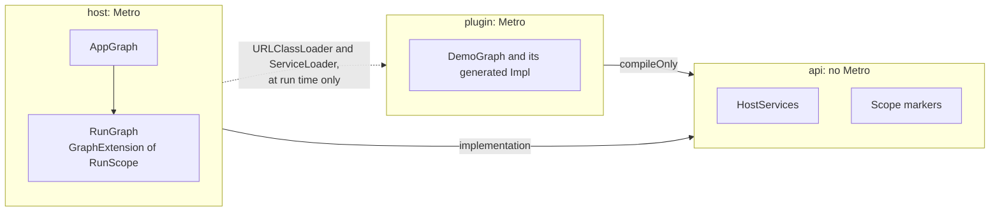

The plugin jar held only plugin classes and Metro's generated `DemoGraph$Impl` and factories. The host loaded it through a `URLClassLoader` whose parent was the host loader. The Metro runtime came from the host classpath with no extra configuration.

| Case | Result |
|---|---|
| Plugin class and jar absent from the host's compile classpath | Worked |
| Host services passed through `@Includes host: HostServices` reach plugin constructors | Worked: an injected sink received messages |
| `@SingleIn(PluginScope)` resolver | The same instance within a generation run, a new instance across generation runs |
| App singleton | Shared across generation runs |
| `@AssistedInject` with `@AssistedFactory`, mixing a runtime argument and an injected `Clock` | Worked |
| Every Metro API name used in this document | Exists in 1.5.2 |
| **Expected failure:** plugin graph as a `@GraphExtension(RunScope)` of the host, with its factory `@ContributesTo(AppScope)` | Compiles, then fails at run time: `ClassCastException: AppGraph$Impl$RunGraphImpl cannot be cast to PluginRunGraph$Factory`. The host graph is generated when the host compiles and cannot know the plugin. |
| **Expected failure:** plugin `@ContributesIntoSet(RunScope)` into the host graph | Compiles and loads, but the host set is empty at run time. The host also fails to compile with `[Metro/EmptyMultibinding]` until the set is declared `@Multibinds(allowEmpty = true)`. Aggregation happens only when the host compiles. |

The two expected failures confirm why each plugin has a standalone graph.

The spike also showed that scope markers used on both sides of the boundary must live in the shared API module.

### Acceptance tests for slice 0

Slice 0 automates these scenarios as integration tests. Each one composes several stages with real collaborators and loads built plugin jars through a class loader, as `AGENTS.md` asks of the integration layer.

| Scenario | What it protects |
|---|---|
| Two separately compiled plugins loaded together | The plugin boundary works across jars with no shared compile classpath. |
| Two plugins with a conflicting contribution | The conflict rules in [Conflicts](#conflicts): merge identical content, fail on differing content, and name both plugin ids. |
| Duplicate plugin id | The generation run fails before the pipeline starts, and the error names the id. |
| A plugin whose `services` throws | One failing plugin fails the whole generation run, with a diagnostic that names it. No partial loading. |
| Two concurrent `generate` calls in one JVM | App-scoped seams are thread-safe. Diagnostics and progress do not leak between runs. |
| Repeated script runs with different plugin class loaders | No stale instances survive a script run. The class loader becomes collectable. |
| The pipeline fails midway | Every plugin's `PluginServices` is still closed, in reverse order. |
| Shuffled discovery order | Output is byte-identical whatever the `ServiceLoader` order. |
| A Metro-using plugin against a different Metro runtime | Behaviour matches the outcome of [open question 14](#14-metro-policy-for-third-party-plugins): a clear incompatibility report, or a working relocated plugin. |

Most of these are plain host behaviour. They are ordinary tests, written with the foundation slice. Two carry a real unknown and need a spike first:

- **The Metro version case.** It is not yet known whether relocating a plugin's Metro runtime works.
- **Class loader collectability.** It is not yet known what keeps a plugin class loader reachable after a script run, such as thread locals, shutdown hooks or cached reflection data.

## Settled questions

The ten questions that were open on the first draft now have outcomes. The numbers are kept so that earlier discussion still maps.

| # | Question | Outcome | Where |
|---|---|---|---|
| 1 | Where script symbol contributors live, since they are needed outside a generation run | A separate, optional contract, `MicrosmithScriptingPlugin`, in `runtime-scripting-api`. It is not a method on `MicrosmithPlugin`, and `scriptSymbolContributors` leaves `PluginServices`. | [Plugin API](#plugin-api) |
| 2 | Script entry points that the scripting framework instantiates | The host puts the symbol registry in a `ScriptingHostConfiguration` key. Refiners fall back to discovery when the key is absent, as in the IDE. Script-definition objects join Mappie mappers as exceptions to Rule 1. | [Exceptions to the rules](#exceptions-to-the-rules) |
| 3 | Paths in pipeline models | A file-system-independent relative-path value type in `artifact`, covering ids, output roots and `GeneratedFile`. | [Paths in pipeline models](#paths-in-pipeline-models) |
| 4 | DSL entry points as extensions | An explicit exception to the extension rule. | [Exceptions to the rules](#exceptions-to-the-rules) |
| 5 | Where the plugin API lives | `ArtifactRenderer` and `GeneratedFile` move down. Plugins do not compile against `gen`. | [Where the plugin API lives](#where-the-plugin-api-lives) |
| 6 | What counts as one built-in plugin | One plugin per module family. | [Built-in plugins](#built-in-plugins) |
| 7 | The script compile cache is not immutable | It is script-run state, built once per script run. The app singleton keeps only the cache directory and fingerprint policy. | [Lifetimes](#lifetimes) |
| 8 | Coroutine dispatcher | A host binding, not exposed to plugins. | [I/O seams](#io-seams), [Coroutines and `suspend`](#coroutines-and-suspend) |
| 9 | Clock type | `kotlin.time.Clock`, which is stable since Kotlin 2.3. A separate `TimeSource` measures durations. | [Time: two seams](#time-two-seams) |
| 10 | Overlap with #204 and #205 | Land #204 before slice 4, and #205 with slice 5. | [Migration plan](#migration-plan) |

## Open questions

Answer by number.

### 11. Coroutine direction

**Problem.** The host is `suspend` in `gen` only, with one `runBlocking` buried in the script host. Processes cannot be cancelled and nothing runs concurrently. [Coroutines and `suspend`](#coroutines-and-suspend) describes the three directions.

**Options.**

- a. Keep as is, and only move the dispatcher to a host binding.
- b. Structured concurrency in the host. Plugin contracts stay blocking.
- c. `suspend` everywhere, including the plugin contracts.

**Recommendation.** b. It gives cancellation, timeouts and safe parallel writes, and it costs plugin authors nothing. Option a keeps today's gaps. Option c colours every plugin for no gain, because every service interface is a pure CPU transform. The Decision section already assumes b.

### 12. Concurrent calls into one plugin's services

**Problem.** May the host call one plugin's services from several threads within a generation run? Parallel rendering needs it. The answer becomes part of the plugin contract, and it cannot be tightened later without breaking plugins.

**Options.**

- a. Never. Plugin calls stay sequential, and only host I/O is parallel.
- b. Yes. The contract says that plugin services must be stateless or thread-safe within a generation run.

**Recommendation.** b. Declare it in 4.0, and exercise it with parallel rendering in slice 0, so the contract is tested from the start. Adding it after 4.0 would be a breaking change. The cost is real: every plugin author takes on the obligation.

### 13. A plugin descriptor beyond `id`

**Problem.** Should a plugin declare more about itself than an `id`?

**Options.**

- a. `id` only. Compatibility is defined by the semver of the plugin API module, and by `LinkageError` reporting.
- b. Also a self-declared `version` and `apiVersion`.

**Recommendation.** a. A declared `apiVersion` is read by instantiating the class. That is exactly what fails when the API is incompatible, so it cannot give the clear error it promises. A check that works would have to read jar metadata without loading classes. That can be added later without breaking plugins.

### 14. Metro policy for third-party plugins

**Problem.** A third-party plugin that uses Metro works only against the Metro version the host ships. See [Metro across the plugin boundary](#metro-across-the-plugin-boundary). What do we ask of plugin authors?

**Options.**

- a. Third-party plugins compile against the exact Metro version that microsmith publishes for each release. Release notes flag every Metro bump as "rebuild Metro-based plugins".
- b. Third-party plugins that use Metro relocate (shade) their own Metro runtime, so they are self-contained. This is safe by design, because no Metro type crosses the boundary.
- c. Document hand-wiring as the recommended route for third-party plugins, and support Metro for built-ins only.

**Recommendation.** b if a slice 0 spike proves that relocation works. Otherwise c. Option a alone is weak: it breaks plugins on a minor release.

[Back to the README](../../README.md)
