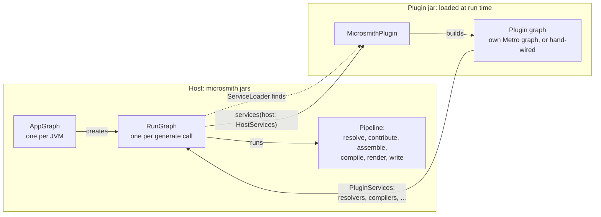
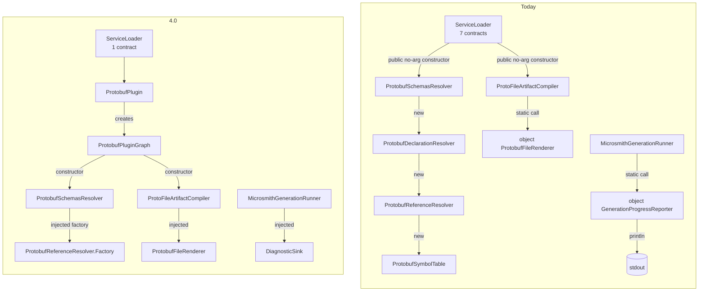
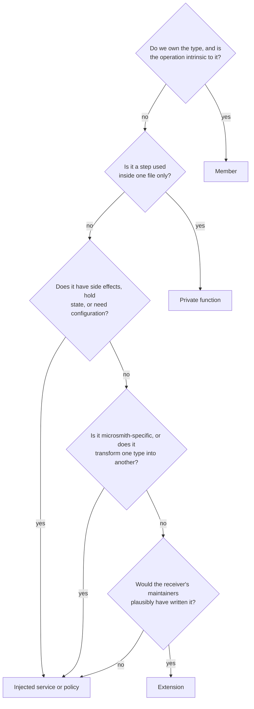
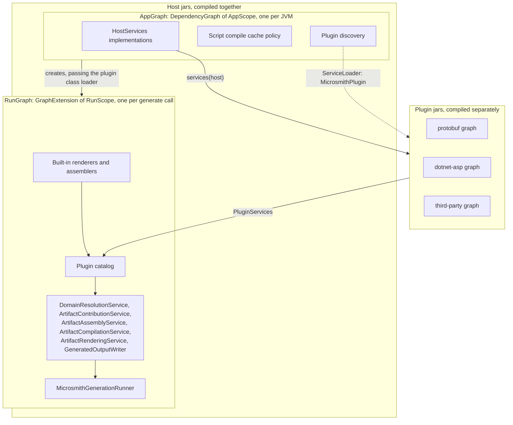
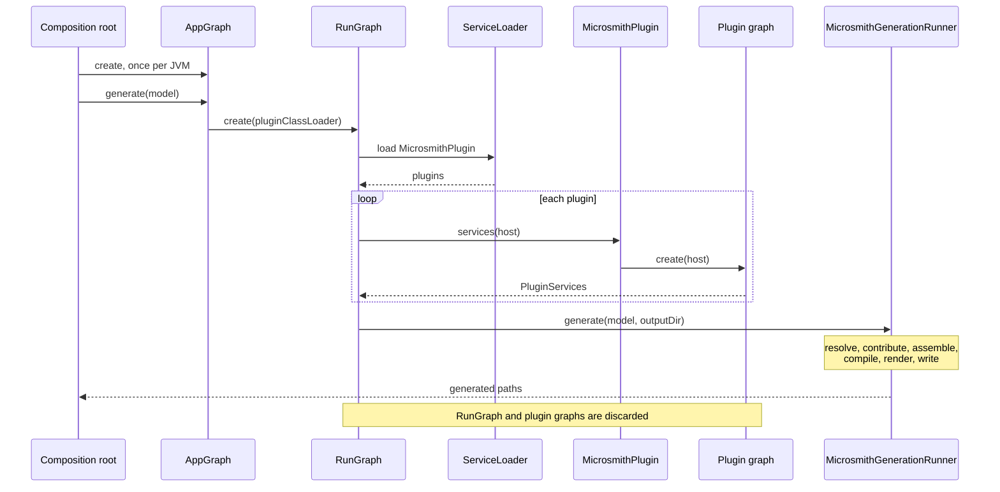
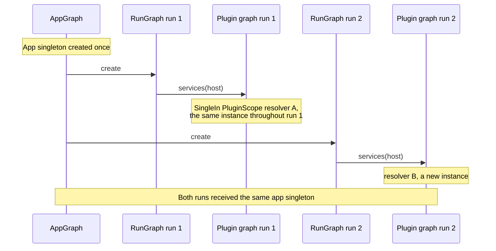
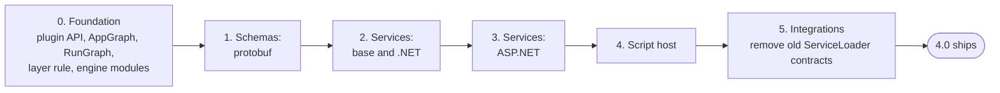
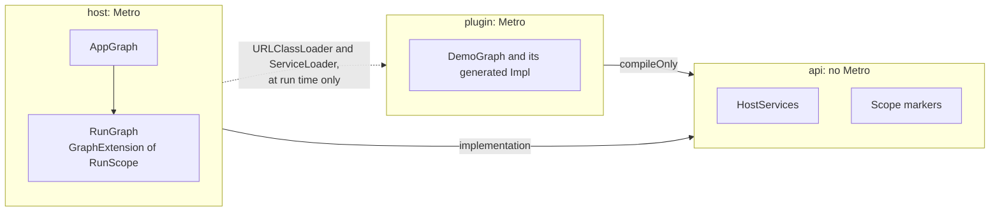
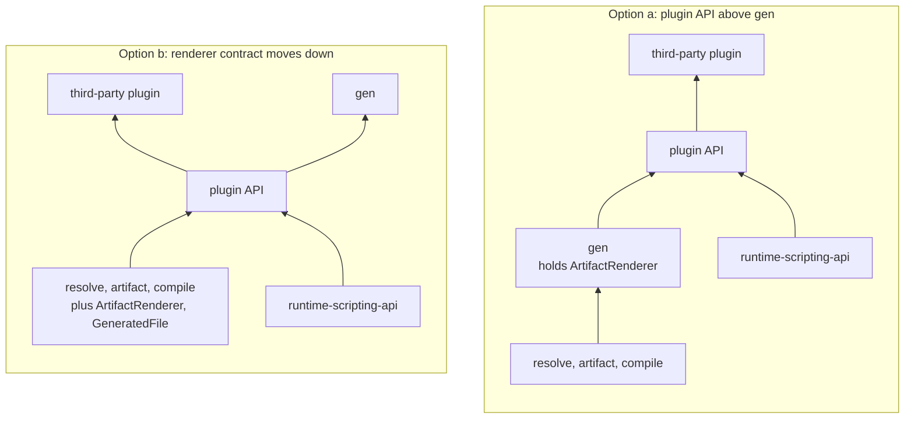

# Dependency injection in 4.0

**Status:** Proposed

**Milestone:** v4.0.0, together with #203 (explicit API mode)

## Summary

Today only `gen` uses Metro. Every other module builds its own collaborators, keeps behaviour in `object`s, and calls the file system, clock, environment and processes directly. Plugins join through seven `ServiceLoader` contracts. In 4.0, every service gets its collaborators through its constructor. The host owns two Metro graphs: an app graph that lives as long as the JVM, and a run graph for each `generate` call. Each plugin is found through one interface, `MicrosmithPlugin`, and builds its own graph from the host services it is given. No Metro type crosses the plugin boundary. I/O sits behind six injected seams, so unit tests can replace it. The change ships with #203 and moves one module family at a time.

## The design at a glance



Only three microsmith interfaces cross between the two boxes: `MicrosmithPlugin`, `HostServices` and `PluginServices`.

## Glossary

| Term | Meaning here |
|---|---|
| Service | An object that does work: a resolver, a renderer, a writer. Contrast with a value, such as `ResolvedProtobufMessage` or `GeneratedFile`. |
| Graph | A Metro `@DependencyGraph`: an interface from which Metro generates the code that builds services and their collaborators. |
| Binding | A rule in a graph that says how to get one type, such as an `@Inject` constructor or a `@Provides` function. |
| Scope | A marker type that ties an instance to a graph's lifetime. `@SingleIn(RunScope::class)` means one instance per `RunGraph`. |
| Graph extension | A Metro `@GraphExtension`: a child graph created from a parent. It sees the parent's bindings and lives for a shorter time. |
| Contribution | A Metro annotation such as `@ContributesTo` or `@ContributesIntoSet` that adds a binding to a graph from another module. Metro gathers contributions when it compiles the graph. |
| `@Includes` | A graph factory parameter whose properties become bindings. A plugin graph uses `@Includes host: HostServices` to see the host's services. |
| Assisted injection | A constructor that takes some arguments at call time and the rest from the graph. Metro generates a factory for it (`@AssistedInject`, `@AssistedFactory`). |
| ServiceLoader | `java.util.ServiceLoader`: the JDK mechanism that finds implementations listed in a jar's `META-INF/services` files. |
| Composition root | The entry point that creates the first graph, such as `Cli.main`. |
| ABI | A module's public binary interface: what another jar can compile against. #207 checks it with ABI dumps. |
| Jimfs | An in-memory `java.nio.file.FileSystem` for tests. |

## Context

### Today versus 4.0



Composition happens in two ways today.

- `gen` uses Metro. `MicrosmithGenerationGraph` is an `internal` graph whose factory takes a `MicrosmithPluginCatalog`. `MicrosmithModel.generate` builds a new graph on every call. `verifyModuleLayers` fails the build if any other module applies Metro (`metroViolations` in `build-logic/.../layers/ModuleLayers.kt`).
- Every other module wires itself by hand. Plugins join through `ServiceLoader` over seven contracts: `discoverMicrosmithPlugins` loads six, and `ScriptSymbolContributorRegistry.discover` loads the seventh. Each implementation needs a public no-argument constructor.

This produces four problems.

### Problem 1: services build their own collaborators

A `ServiceLoader` plugin cannot receive collaborators, so it constructs them.

```kotlin
// resolve-schemas-protobuf: ProtobufSchemasResolver.resolve
val resolver = ProtobufDeclarationResolver(ProtobufReferenceResolver(ProtobufSymbolTable(symbols)))

// resolve-services-dotnet-asp: DotnetAspWorkspaceResolver
class DotnetAspWorkspaceResolver(
    private val dotnetWorkspaceResolver: DotnetWorkspaceResolver = DotnetWorkspaceResolver(),
) {
    private val restResolver = DotnetAspRestResolver()
```

`DotnetWorkspaceResolver()` is built by a default argument in three places: `DotnetWorkspaceDomainResolver`, `DotnetAspWorkspaceResolver` and `DotnetPackageWorkspaceResolver`.

### Problem 2: behaviour lives in `object`s

Main code has 84 top-level `object` declarations. About a dozen are Mappie mappers, which must be objects. Most of the rest are stateless services that a test cannot replace: `ProtobufFileRenderer`, `DotnetAspProjectRenderer`, `DotnetAspPortAllocator`, `GeneratedOutputPathResolver`, `GeneratedOutputUniquenessValidator`, `GenerationProgressReporter`, `ScriptEvaluator`, `ScriptContextFactory`, `PluginClassLoaderScope`.

### Problem 3: I/O, environment, clock and processes are called directly

84 of the 724 main source files do this. They cluster at the edges of the system.

| Module group | Files |
|---|---|
| `cli` | 41 |
| `runtime-scripting` | 11 |
| `gradle-plugin` | 6 |
| `gen` | 6 |
| All `resolve-*`, `artifact-*` and `compile-*` modules together | about 6 |

Typical calls:

| Where | Direct call |
|---|---|
| `GenerationProgressReporter` | `println("Generated all files in ...")` |
| `TemporaryDirectory` | `Files.createTempDirectory`, `System.currentTimeMillis()`, `System.err.println` |
| `ScriptHostPaths`, `PluginResolutionPaths` | `System.getenv`, `System.getProperty("user.home")`, `Path.of` |
| `CliDiagnosticEmitter`, `EventLogWriter` | `Instant.now()` |
| `DefaultMicrosmithGradleWorkerProcessExecutor` | `ProcessBuilder(command).start()` |
| `MicrosmithGradleWorkerLauncher` | `System.getProperty("java.home")`, `System.getProperty("os.name")` |

### Problem 4: function parameters stand in for injection

`MicrosmithCli` takes 11 function-typed constructor parameters with defaults, such as `stdout: (String) -> Unit = ::println` and a `scriptRunner` that constructs `MicrosmithScriptHost()`. `RunCommandHandler` repeats the same `scriptRunner` default. The CLI is testable, but its wiring is duplicated and hidden in default arguments.

### The link to #203

#203 makes everything outside the intended API `internal`. Its dry run found 1,391 explicit-API warnings across 38 modules. A sample of 15 split 8 : 4 : 3 into intended API, should-be-internal, and public only because another module or `ServiceLoader` needs it. `BinaryFileArtifactAssembler` is in the last group. Once a plugin graph builds its services, they no longer need to be public. So the two changes decide visibility together.

## Goals and non-goals

| Goals | Non-goals |
|---|---|
| One rule for where logic lives, applied the same way in every module. | Plugins that replace host services, or inject each other's services. |
| Constructor injection for every service, checked at build time within each compilation unit. | A runtime container, reflection-based injection or a service locator. |
| I/O, clock, environment, console and processes behind injected seams that unit tests can replace. | Changing the pipeline stages, or the resolved-model and typed-failure rules in [Architecture principles](../architecture-principles.md). |
| A public plugin API made only of microsmith interfaces, with no Metro types. | A compatibility layer for 3.x plugins. |
| Lifetimes that are safe in long-lived JVMs (Maven, `mvnd`, the IDE) whose plugin classpaths change between builds. | |
| Visibility and injection decided together, family by family, with #203. | |

## Decision

### 1. Where logic lives

Every operation has exactly one of four homes. Ask these questions in order.



| Home | Use when | Example |
|---|---|---|
| Member | We own the type and the operation is intrinsic to it. | `ChangelogExtension.merge`, `ResolvedProtobufMessage.of` |
| Extension | A general operation the receiver's maintainers could have written. Never microsmith-specific. Never side-effecting. | `String.toSnakeCase()` |
| Injected service or policy | Microsmith-specific, side-effecting, stateful, configurable, or transforming between types. | Rendering a resolved message as C#; the .NET naming policy; `GeneratedOutputWriter` |
| Private function | A step inside one file. | `requireNoSymlinkTraversal` in `GeneratedOutputPathResolver` |

Four rules follow from the table.

**Rule 1: no `object` with behaviour, except Mappie mappers.** `object` is still fine for constants, for `data object` values such as `ChangelogArtifactId`, and for members of sealed hierarchies.

```kotlin
// Before
internal object ProtobufFileRenderer { fun render(artifact: ProtoFileArtifact): String = ... }

// After
@Inject internal class ProtobufFileRenderer { fun render(artifact: ProtoFileArtifact): String = ... }
```

**Rule 2: no service builds another service.** A service lists what it needs in its constructor.

```kotlin
// Before: compile-schemas-protobuf
@ServiceProvider(ArtifactCompiler::class)
class ProtoFileArtifactCompiler : SchemasArtifactCompiler<ProtoFileArtifact> {
    override fun compile(artifact: ProtoFileArtifact) =
        listOf(TextFileArtifactContribution(TextFileArtifactId(artifact.id.relativePath), ProtobufFileRenderer.render(artifact)))
}

// After
@Inject
internal class ProtoFileArtifactCompiler(private val renderer: ProtobufFileRenderer) : SchemasArtifactCompiler<ProtoFileArtifact> {
    override fun compile(artifact: ProtoFileArtifact) =
        listOf(TextFileArtifactContribution(TextFileArtifactId(artifact.id.relativePath), renderer.render(artifact)))
}
```

The compiler becomes `internal`, because the plugin graph builds it instead of `ServiceLoader`.

**Rule 3: values are constructed directly.** Injection is for services. `ResolvedProtobufMessage` and `GeneratedFile` are still built with their constructors or `of` functions.

**Rule 4: use a factory when construction needs both runtime values and services.** See [Factories](#7-factories).

How existing code maps onto the rules:

| Today | 4.0 |
|---|---|
| `internal object ProtobufFileRenderer` | `@Inject internal class ProtobufFileRenderer` |
| `internal object DotnetAspPortAllocator` | An injected service. Port allocation is a microsmith-specific policy. |
| `internal fun dotnetAspPascalIdentifier(identifier: String)` | A method on an injected .NET naming policy |
| `artifact.textContribution("Program.cs", ...)` in `compile-services-dotnet-asp` | A private function in the compiler's file, or a member of a contribution-builder service |
| `ProtobufDeclarationResolver(ProtobufReferenceResolver(ProtobufSymbolTable(symbols)))` | `ProtobufReferenceResolver.Factory.create(symbols)`, with the factory injected |

### 2. Plugin API

The public plugin API is three microsmith interfaces. None of them mentions Metro.

```kotlin
public interface MicrosmithPlugin {
    public fun services(host: HostServices): PluginServices
}

public interface HostServices {
    public val fileSystem: java.nio.file.FileSystem
    public val clock: Clock
    public val diagnostics: DiagnosticSink
    public val console: Console
    public val environment: Environment
    public val processLauncher: ProcessLauncher
}

public interface PluginServices {
    public val domainResolvers: Set<DomainResolver<*, *>> get() = emptySet()
    public val resolutionIssueDiagnosticMappers: Set<ResolutionIssueDiagnosticMapper<*>> get() = emptySet()
    public val artifactContributors: Set<ArtifactContributor<*>> get() = emptySet()
    public val artifactAssemblers: Set<ArtifactAssembler<*>> get() = emptySet()
    public val artifactCompilers: Set<ArtifactCompiler<*>> get() = emptySet()
    public val artifactRenderers: Set<ArtifactRenderer<*>> get() = emptySet()
    public val scriptSymbolContributors: Set<ScriptSymbolContributor> get() = emptySet()
}
```

- `ServiceLoader` finds `MicrosmithPlugin` only. The seven `META-INF/services` files in [Plugin development](../plugin-development.md#6-registration) become one.
- A plugin may build its services with its own Metro graph, or wire them by hand. The host cannot tell the difference.

A plugin that uses Metro:

```kotlin
@DependencyGraph(ProtobufPluginScope::class)
internal interface ProtobufPluginGraph : PluginServices {
    @DependencyGraph.Factory
    fun interface Factory {
        fun create(@Includes host: HostServices): ProtobufPluginGraph
    }
}

public class ProtobufPlugin : MicrosmithPlugin {
    override fun services(host: HostServices): PluginServices =
        createGraphFactory<ProtobufPluginGraph.Factory>().create(host)
}
```

**Why each plugin has a standalone graph.** Metro gathers contributions when it compiles a graph. So a jar loaded at run time cannot contribute to the host graph. A graph extension also cannot be compiled apart from its parent. The [spike](#spike-results) confirms both.

**Limits we accept.**

- A plugin cannot replace a host service.
- Plugins cannot inject each other's services. They meet only through pipeline models: resolved models, artifacts and contributions.

### 3. Host composition



- **`AppGraph`** replaces `MicrosmithGenerationGraph`. The composition roots create it: `Cli.main`, `MicrosmithGradleWorkerMain`, `ProcessIsolatedScriptMain` and `MicrosmithGenerateMojo.execute`.
- **`RunGraph`** is a `@GraphExtension(RunScope::class)` of `AppGraph`. Its factory takes the plugin class loader. It calls `services(host)` on every discovered `MicrosmithPlugin` and merges the results into the catalog.
- **Built-ins are bound, not discovered.** `RunGraph` binds `TextFileArtifactRenderer`, `BinaryFileArtifactRenderer`, `TextFileArtifactAssembler` and `BinaryFileArtifactAssembler` directly.
- **The layer rule changes.** "Metro only in gen" is replaced by two rules:
  1. No published API module (`dsl`, `resolve`, `artifact`, `compile`, the plugin API module, `runtime-scripting-api`) exposes a Metro type in its ABI. The ABI dumps from #207, which ship in 3.0.0, can check this.
  2. Metro scope markers used on both sides of the boundary live in the plugin API module.

### 4. One `generate` call



### 5. Lifetimes

| Lifetime | Scope | Holds | Rule |
|---|---|---|---|
| App singleton | `AppScope` | `HostServices`, script compile cache policy | Immutable state only, and nothing that depends on the plugin class loader. |
| Per run | `RunScope`, and each plugin graph's own scope | Pipeline services, plugin services | One `generate` call. A plugin's `@SingleIn` means once per run. |
| Transient | none | Most services | A new instance per injection. The default. |

The spike observed this across two runs in one JVM:



**Why app singletons are restricted.** One JVM can run many builds with different plugin classpaths. An app singleton that held a plugin class would leak its class loader and could hand a stale class to the next build.

Where a JVM is reused today:

| Host | Where generation runs | Consequence |
|---|---|---|
| Maven | In the build JVM. `MicrosmithGenerateMojo` is `threadSafe = true`. | A parallel build can run several `generate` calls at once, so app singletons must be thread-safe. |
| IDE | The IDE process loads `MicrosmithScriptCompilationConfiguration`, whose refiner calls `ScriptSymbolContributorRegistry.discover()`. | Plugin code runs in a long-lived JVM. |
| Gradle | In a new JVM for every task execution, started by `MicrosmithGradleWorkerLauncher`. | Not the case that drives the rule, but the rule still holds. |

**Per-script scope is dropped.** Every entry point evaluates exactly one script per request. `ScriptRunRequest` has one `script`, and the CLI, the Gradle worker and the Maven mojo each build one request. A script can call `emit` or `generate` more than once, because `MicrosmithScriptContext.emit` accumulates `generatedRoots`. Each call is its own run. Script symbol contributors are the exception: see [open question 1](#1-script-symbol-contributors-live-outside-a-run).

### 6. I/O seams

Each seam is its own interface on `HostServices`.

| Seam | Replaces | Main users today |
|---|---|---|
| `java.nio.file.FileSystem` | `Path.of`, `Paths.get`, and the default file system behind `Files.*` | `gen` output writing, `cli` plugin cache and lockfiles, `ScriptHostPaths` |
| `Clock` | `Instant.now()`, `System.currentTimeMillis()`, `System.nanoTime()` | `CliDiagnosticEmitter`, `EventLogWriter`, `TemporaryDirectory`, `ScriptEvaluator` |
| `DiagnosticSink` | Ad hoc warnings and progress on stdout or stderr | `GenerationProgressReporter`, `TemporaryDirectory.close` |
| `Console` | `println`, `System.err.println`, and `MicrosmithCli`'s `stdout` and `stderr` lambdas | `cli`, `ProcessIsolatedScriptMain`, `MicrosmithGradleWorkerMain` |
| `Environment` | `System.getenv`, `System.getProperty` | `ScriptHostPaths`, `PluginResolutionPaths`, `DoctorPaths`, `RepositoryAllowlistPolicy`, `DefaultRepositoryCredentialsResolver`, `MicrosmithGradleWorkerLauncher` |
| `ProcessLauncher` | `ProcessBuilder` | `DefaultMicrosmithGradleWorkerProcessExecutor`, `JvmProcessIsolationWorkerLauncher` |

```kotlin
// Before: ScriptHostPaths
val envPath = System.getenv("MICROSMITH_SCRIPT_CACHE_DIR")?.trim()?.takeIf { it.isNotEmpty() }
return Path.of(System.getProperty("user.home"), ".microsmith", "cache", "scripts")

// After (Environment method names are illustrative)
val envPath = environment.variable("MICROSMITH_SCRIPT_CACHE_DIR")?.trim()?.takeIf { it.isNotEmpty() }
return fileSystem.getPath(environment.property("user.home"), ".microsmith", "cache", "scripts")
```

`Path.of` and `Paths.get` are banned in main code in favour of `fileSystem.getPath`. A build check enforces the ban.

Some APIs accept only the default file system: Kotlin scripting (`FileScriptSource`, `CompiledScriptJarsCache`, and `updateClasspath`, which take `java.io.File`) and `URLClassLoader`. Code that calls them stays on the default file system, and integration tests cover it.

### 7. Factories

Use assisted injection when a service needs a value known only at call time as well as injected services.

```kotlin
// Before: ProtobufSchemasResolver.resolve
val resolver = ProtobufDeclarationResolver(ProtobufReferenceResolver(ProtobufSymbolTable(symbols)))

// After
@AssistedInject
internal class ProtobufReferenceResolver(
    @Assisted private val symbols: ProtobufSymbolTable,
    private val naming: ProtobufNamingPolicy,
) {
    @AssistedFactory
    fun interface Factory {
        fun create(symbols: ProtobufSymbolTable): ProtobufReferenceResolver
    }
}
```

Candidates in today's code:

| Type | Value known at call time | Injected services |
|---|---|---|
| `ProtobufReferenceResolver`, `ProtobufDeclarationResolver` | The symbol table built in `ProtobufSchemasResolver.resolve` | Naming and validation policies |
| `TemporaryDirectory` (today `TemporaryDirectory.create`) | A per-run prefix | File system, clock |
| `MicrosmithScriptCache` | The cache directory and the plugin classpath fingerprint | File system |
| `MicrosmithScriptContext` (today `ScriptContextFactory.create`) | The output path and the request | The generation entry point |

Do not use a factory for a value. `DirectorySpace.from(path)` builds a value but also calls `Files.createDirectories`. The side effect moves into a service, and `DirectorySpace` keeps a plain constructor.

### 8. Testing

| Layer | File system | Clock, process, environment |
|---|---|---|
| Unit | May inject an in-memory file system (Jimfs) through the injected `FileSystem`. | Injected fakes. |
| Integration and end-to-end | Real temporary directories, to catch real permissions, symbolic links and OS paths. For example, `GeneratedOutputPathResolver`'s symbolic-link checks need a real file system. | Real, unless the test is about them. |

Tests use a plugin's real graph or hand-wired real collaborators. They do not use a test container.

Changes to `AGENTS.md`:

| Line today | Becomes |
|---|---|
| Unit layer row: "A temporary directory is allowed when the unit writes files." | "An in-memory file system is allowed when the unit reads or writes files." |
| "Use a test double only at a boundary: network, file system, clock." | "Use a test double only at a boundary: network, file system, clock, process, environment." |
| "Use a temporary directory instead of a fake file system." | "In unit tests, use an in-memory file system through the injected `FileSystem`. In integration and end-to-end tests, use a real temporary directory." |

## Alternatives considered

| Option | For | Against | Verdict |
|---|---|---|---|
| **Koin** | Its runtime modules are the closest match to ASP.NET's `IServiceCollection`. A runtime container can take contributions from jars loaded later. | Koin types would enter the public plugin API. Missing bindings surface at run time. Koin Annotations is moving to a compiler plugin, which adds the same Kotlin-version coupling as Metro. | Rejected |
| **kotlin-inject** | Checks graphs at compile time. | No runtime aggregation either, so the plugin boundary stays the same. Adds a KSP step to every module. Metro covers the same ground and is already in the build. | Rejected |
| **Custom container** | A runtime registry keyed by type would let plugins contribute to the host. | Gives up build-time checking in every module. Microsmith would have to maintain it. | Rejected |
| **Inject everything** | One uniform mechanism. | Extensions, private helpers and value construction would go through the graph. More wiring with no easier testing, because pure functions are already testable directly. | Rejected |
| **Status quo** | Works today. | Keeps public no-argument constructors as an API requirement, against #203. Keeps I/O untestable outside `cli`. Leaves inline construction in place. | Rejected |

## Consequences and risks

| Risk | Detail |
|---|---|
| Compiler-plugin coupling | Metro is a Kotlin compiler plugin, and each Metro release supports a narrow range of Kotlin versions. Today only `gen` is coupled. After this change, every module that uses Metro, and every third-party plugin that chooses to, must upgrade Kotlin and Metro together. A hand-wired plugin has no such coupling. |
| Every third-party plugin must migrate | Seven `META-INF/services` registrations become one `MicrosmithPlugin`. Public no-argument constructors are no longer needed. This is a 4.0 breaking change. The release notes need a migration section, and [Plugin development](../plugin-development.md) needs a rewrite. |
| Two kinds of checking | Metro checks a plugin's graph when the plugin compiles. The boundary between host and plugin is checked at run time: a missing or failing `MicrosmithPlugin` shows up only when a run discovers it. The boundary is deliberately small: one method and two interfaces. |
| Size | About 724 main files across 38 published modules, plus #203's 1,391 explicit-API warnings. Splitting by module family keeps each pull request reviewable. |

## Migration plan

Each slice decides injection and visibility for its modules together.



| # | Slice | Modules | Main files | #203 warnings | Direct-I/O files |
|---|---|---|---|---|---|
| 0 | Foundation | Plugin API module (`MicrosmithPlugin`, `HostServices`, `PluginServices`, seam interfaces); `AppGraph` and `RunGraph` in `gen`; replacement layer rule and `Path.of` check; `dsl`, `resolve`, `artifact`, `compile`, `gen` | 65 | 127+ (`dsl` 34, `artifact` 37, `gen` 34, `resolve` 22; `compile` not reported separately) | 6, in `gen` |
| 1 | Schemas: protobuf | `schemas/base`, `schemas/protobuf`, `schemas/protobuf-rpc` | 175 | `dsl-schemas-protobuf` 213, `resolve-schemas-protobuf` 145 | few |
| 2 | Services: base and .NET | `services/base`, `services/dotnet`, `services/dotnet-packages` | 120 | `dsl-services-dotnet` 226, `compile-services-dotnet` 158, `dsl-services` 58 | few |
| 3 | Services: ASP.NET | `services/dotnet-asp` | 119 | `dsl-services-dotnet-asp` 80, `resolve-services-dotnet-asp` 73 | few |
| 4 | Script host | `runtime-scripting`, `runtime-scripting-api` | 62 | 44 | 11 |
| 5 | Integrations | `cli`, `gradle-plugin`, `maven-plugin` | 183 | 23 | 47 |

- Until slice 5, the host discovers both the old `ServiceLoader` contracts and `MicrosmithPlugin`, so built-in families can move one at a time. Slice 5 removes the old contracts before 4.0 ships.
- Slices 1 to 3 are mostly about objects, inline construction and visibility. The I/O work is in slices 4 and 5.
- Each slice updates the docs it makes untrue: `docs/architecture-principles.md` ("Metro is internal", "ServiceLoader boundary"), `docs/contributing.md` (module layering), `docs/plugin-development.md` and `AGENTS.md`.

## Validation

A two-module spike tested the graph boundary across separately compiled jars.

### Spike results

Setup: Kotlin 2.4.21, Metro 1.5.2, Gradle 9.9.1, JDK 25.



The plugin jar held only plugin classes and Metro's generated `DemoGraph$Impl` and factories. The host loaded it through a `URLClassLoader` whose parent was the host loader. The Metro runtime came from the host classpath with no extra configuration.

| Case | Result |
|---|---|
| Plugin class and jar absent from the host's compile classpath | Worked |
| Host services passed through `@Includes host: HostServices` reach plugin constructors | Worked: an injected sink received messages |
| `@SingleIn(PluginScope)` resolver | The same instance within a run, a new instance across runs |
| App singleton | Shared across runs |
| `@AssistedInject` with `@AssistedFactory`, mixing a runtime argument and an injected `Clock` | Worked |
| Every Metro API name used in this document | Exists in 1.5.2 |
| **Expected failure:** plugin graph as a `@GraphExtension(RunScope)` of the host, with its factory `@ContributesTo(AppScope)` | Compiles, then fails at run time: `ClassCastException: AppGraph$Impl$RunGraphImpl cannot be cast to PluginRunGraph$Factory`. The host graph is generated when the host compiles and cannot know the plugin. |
| **Expected failure:** plugin `@ContributesIntoSet(RunScope)` into the host graph | Compiles and loads, but the host set is empty at run time. The host also fails to compile with `[Metro/EmptyMultibinding]` until the set is declared `@Multibinds(allowEmpty = true)`. Aggregation happens only when the host compiles. |

The two expected failures confirm why each plugin has a standalone graph.

The spike also showed that scope markers used on both sides of the boundary must live in the shared API module.

## Open questions

Answer by number.

### 1. Script symbol contributors live outside a run

**Problem.** `ScriptSymbolContributorRegistry.discover()` runs in `refineMicrosmithScriptSymbols` at script compile time, and in `refineMicrosmithScriptSymbolValues` before evaluation. Both happen before any `generate` call, and the first also runs in the IDE. No per-run plugin graph exists at those points.

**Options.**

- a. Create plugin graphs once per script evaluation and reuse them for that script's runs. This brings back a per-script scope.
- b. Add a separate, lighter entry point on `MicrosmithPlugin` that returns only script symbol contributors, and remove `scriptSymbolContributors` from `PluginServices`.

**Recommendation.** b. It keeps "one plugin graph per run" intact, and it works in the IDE, where no run exists.

### 2. Entry points that the scripting framework instantiates

**Problem.** Kotlin scripting instantiates `MicrosmithScriptCompilationConfiguration` and `MicrosmithScriptEvaluationConfiguration`. Both are `object`s that call the refiners as top-level functions. They cannot receive constructor injection, and they break the "no `object` with behaviour" rule.

**Options.**

- a. The host puts the symbol registry in a `ScriptingHostConfiguration` key, and the refiners read it from there.
- b. The refiners keep discovering plugins themselves.

**Recommendation.** a, falling back to b when the key is absent, as in the IDE. Add script-definition objects to the rule's exceptions, next to Mappie mappers.

### 3. Paths inside pipeline models

**Problem.** `TextFileArtifactId.relativePath` and `BinaryFileArtifactId` hold `java.nio.file.Path` values. Pure modules build them with `Path.of`: `ProtoFileArtifactId`, `MsBuildProjectArtifactCompiler` and `DotnetAspProjectFileSupport`. These modules have no `FileSystem`. A default-file-system `Path` cannot be resolved against a Jimfs root (`ProviderMismatchException`). The `Path.of` ban would also leave these modules no way to build a path.

**Options.**

- a. A file-system-independent relative-path value type in `artifact`, which `gen` converts to a `Path`. This is a breaking change to `TextFileArtifactId`.
- b. Exempt pipeline models from the ban, and keep unit tests of `gen` on the default file system.

**Recommendation.** a. 4.0 already breaks the plugin API, and pipeline models should not depend on a file system.

### 4. DSL entry points are microsmith-specific extensions

**Problem.** The authoring DSL is built from extension functions such as `MicrosmithScope.changelog`, `SchemasScope.protobuf`, and `RpcScope`'s `String.to`. The rule says an extension is never microsmith-specific.

**Options.**

- a. An explicit exception: DSL entry points on scope types are extensions by design, because a plugin extends a scope it does not own.
- b. Replace them with members or registries.

**Recommendation.** a. Extension functions are how plugins add DSL vocabulary today. Option b is a large redesign outside this change.

### 5. Where the plugin API lives

**Problem.** `PluginServices` names `ArtifactRenderer`, which is in `gen`, and `ScriptSymbolContributor`, which is in `runtime-scripting-api`. So a plugin API module must depend on both.



Arrows point from a dependency to the module that uses it.

**Options.**

- a. The plugin API module sits above `gen`. Plugins compile against `gen`.
- b. `ArtifactRenderer` and `GeneratedFile` move to a lower layer, in the same way that `DomainResolver` lives in `resolve`. `gen` keeps the implementations. Plugins do not compile against `gen`.

**Recommendation.** b. Few plugins write renderers, and a plugin should not need the engine on its compile classpath.

### 6. What counts as one built-in plugin

**Problem.** `resolve-services-dotnet-asp` and `resolve-services-dotnet-packages` both construct `DotnetWorkspaceResolver` from `resolve-services-dotnet`. If each family is its own plugin, they cannot inject each other's services.

**Options.**

- a. One plugin per family: protobuf, protobuf RPC, .NET, ASP.NET and .NET packages. Each family's graph builds `DotnetWorkspaceResolver` as a library class.
- b. One bundled plugin for all built-ins.

**Recommendation.** a. It matches the module families and how third parties will ship. Each family already resolves the .NET workspace on its own today.

### 7. The script compile cache is not immutable

**Problem.** The lifetime rule names the script compile cache as an app singleton. But `MicrosmithScriptCache` holds per-run state (`storedScripts`, `retrievedScripts`, `replayedWarnings`, `storedJar`), and its key includes the plugin classpath fingerprint.

**Recommendation.** Split it. The cache directory and the fingerprinting policy are the app singleton. `MicrosmithScriptCache` is per run and is built by an assisted factory.

### 8. Coroutine dispatcher

**Problem.** `GeneratedOutputWriter`, `TemporaryDirectory.create` and `generateTo` take a `CoroutineDispatcher` that defaults to `Dispatchers.IO`. The decisions do not say where it comes from.

**Options.**

- a. A seam on `HostServices`.
- b. A host binding in `AppGraph`, not exposed to plugins.
- c. It stays a parameter.

**Recommendation.** b. Plugin contracts are not `suspend`, so plugins do not need it, and tests can still bind a test dispatcher.

### 9. Clock type

**Problem.** `HostServices.clock` needs a type.

**Options.**

- a. `java.time.Clock`. A test can fake it with `Clock.fixed`, and it matches `Instant.now(clock)` in `CliDiagnosticEmitter`.
- b. `kotlin.time.Clock`. It matches the Kotlin-first direction of #202.

**Recommendation.** b if `kotlin.time.Clock` is stable in the Kotlin version that 4.0 builds with; otherwise a.

### 10. Overlap with #204 and #205

**Problem.** #204 may change the `ScriptSymbolContributor` contract. #205 settles the `timestamp` format that the injected clock produces.

**Recommendation.** Land #204 before slice 4, and #205 with slice 5, so each contract changes only once.

[Back to the README](../../README.md)
