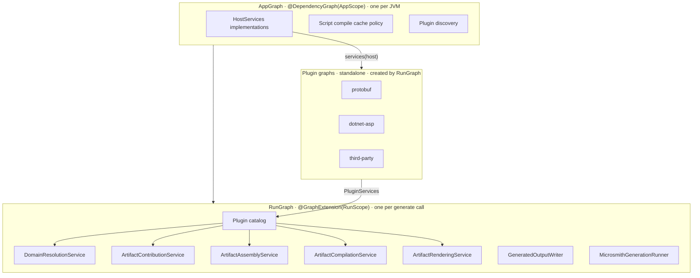

# Dependency injection in 4.0

**Status:** Proposed

**Milestone:** v4.0.0, together with #203 (explicit API mode)

## Context and problem

Microsmith composes its pipeline in two ways today.

`gen` uses Metro. `MicrosmithGenerationGraph` is an `internal` `@DependencyGraph` whose factory takes a `MicrosmithPluginCatalog`. `MicrosmithModel.generate` builds a new graph for every call. The `verifyModuleLayers` task fails the build if any module other than `gen` applies Metro (`metroViolations` in `build-logic/.../layers/ModuleLayers.kt`).

Every other module wires itself by hand, and the plugin boundary is `java.util.ServiceLoader` over seven contracts. `discoverMicrosmithPlugins` loads six of them, and `ScriptSymbolContributorRegistry.discover` loads the seventh. Each implementation needs a public no-argument constructor.

This leads to four recurring patterns.

**Services built inline.** A plugin cannot receive collaborators, so it builds them.

```kotlin
// resolve-schemas-protobuf: ProtobufSchemasResolver.resolve
val resolver = ProtobufDeclarationResolver(ProtobufReferenceResolver(ProtobufSymbolTable(symbols)))

// resolve-services-dotnet-asp: DotnetAspWorkspaceResolver
class DotnetAspWorkspaceResolver(
    private val dotnetWorkspaceResolver: DotnetWorkspaceResolver = DotnetWorkspaceResolver(),
) {
    private val restResolver = DotnetAspRestResolver()
```

`DotnetWorkspaceResolver()` is constructed by default arguments in three places: `DotnetWorkspaceDomainResolver`, `DotnetAspWorkspaceResolver`, and `DotnetPackageWorkspaceResolver`.

**Behaviour in `object` declarations.** The main source sets hold 84 top-level `object` declarations. About a dozen are Mappie mappers, which must be objects. Most of the rest are stateless services that cannot be replaced in a test: `ProtobufFileRenderer`, `DotnetAspProjectRenderer`, `DotnetAspPortAllocator`, `GeneratedOutputPathResolver`, `GeneratedOutputUniquenessValidator`, `GenerationProgressReporter`, `ScriptEvaluator`, `ScriptContextFactory`, `PluginClassLoaderScope`.

**Direct I/O, environment, clock, and process access.** Of 724 main source files, 84 touch these directly: `cli` 41, `runtime-scripting` 11, `gradle-plugin` 6, `gen` 6, and about 6 across all the `resolve-*`, `artifact-*`, and `compile-*` modules. Examples:

| Where | Direct access |
|---|---|
| `GenerationProgressReporter` | `println("Generated all files in ...")` |
| `TemporaryDirectory` | `Files.createTempDirectory`, `System.currentTimeMillis()`, `System.err.println` |
| `ScriptHostPaths`, `PluginResolutionPaths` | `System.getenv`, `System.getProperty("user.home")`, `Path.of` |
| `CliDiagnosticEmitter`, `EventLogWriter` | `Instant.now()` |
| `DefaultMicrosmithGradleWorkerProcessExecutor` | `ProcessBuilder(command).start()` |
| `MicrosmithGradleWorkerLauncher` | `System.getProperty("java.home")`, `System.getProperty("os.name")` |

**Function-typed parameters standing in for injection.** `MicrosmithCli` takes nine lambdas with defaults, such as `stdout: (String) -> Unit = ::println` and a `scriptRunner` that constructs `MicrosmithScriptHost()`. `RunCommandHandler` repeats the same `scriptRunner` default. This makes the CLI testable but duplicates wiring and hides it in default arguments.

A small before-and-after shows the target shape.

```kotlin
// Before: compile-schemas-protobuf
@ServiceProvider(ArtifactCompiler::class)
class ProtoFileArtifactCompiler : SchemasArtifactCompiler<ProtoFileArtifact> {
    override fun compile(artifact: ProtoFileArtifact) =
        listOf(TextFileArtifactContribution(TextFileArtifactId(artifact.id.relativePath), ProtobufFileRenderer.render(artifact)))
}
internal object ProtobufFileRenderer { fun render(artifact: ProtoFileArtifact): String = ... }

// After
@Inject
internal class ProtoFileArtifactCompiler(private val renderer: ProtobufFileRenderer) : SchemasArtifactCompiler<ProtoFileArtifact> {
    override fun compile(artifact: ProtoFileArtifact) =
        listOf(TextFileArtifactContribution(TextFileArtifactId(artifact.id.relativePath), renderer.render(artifact)))
}
@Inject
internal class ProtobufFileRenderer { fun render(artifact: ProtoFileArtifact): String = ... }
```

The compiler becomes `internal` because the plugin graph, not `ServiceLoader`, constructs it. That is the link to #203: the dry run found that some declarations are public only because `ServiceLoader` or another module needs them (`BinaryFileArtifactAssembler` is one).

## Goals

- One rule for where logic lives, applied the same way in every module.
- Constructor injection for every service, with the graph checked at build time within each compilation unit.
- I/O, clock, environment, console, and process access behind injected seams, so unit tests can replace them.
- A public plugin API made only of microsmith-owned interfaces, with no Metro types.
- Lifetimes that are safe in long-lived JVMs (Maven, `mvnd`, the IDE) whose plugin classpaths change between builds.
- Visibility and injection decided together, family by family, so #203 and this change land as one migration.

## Non-goals

- Plugins that replace host services, or that inject each other's services.
- A runtime container, reflection-based injection, or a service locator.
- Changing the pipeline stages, the resolved-model rules, or the typed-failure rules in [Architecture principles](../architecture-principles.md).
- A compatibility layer for 3.x plugins.

## Decision

### Where logic lives

Every operation has one of four homes.

| Home | Use when | Example in microsmith |
|---|---|---|
| Member | We own the type and the operation is intrinsic to it. | `ChangelogExtension.merge`, `ResolvedProtobufMessage.of` |
| Extension | The operation is general, and the receiver's maintainers could plausibly have written it. Never microsmith-specific, never side-effecting. | `String.toSnakeCase()` |
| Injected service or policy | The operation is microsmith-specific, side-effecting, stateful, configurable, or transforms one type into another. | Rendering a resolved message as C#, the .NET naming policy (`dotnetAspPascalIdentifier` today), `GeneratedOutputWriter` |
| Private function | A step inside one file. | `requireNoSymlinkTraversal` in `GeneratedOutputPathResolver` |

Consequences:

- No `object` with behaviour, except Mappie mappers. `object` stays allowed for constants, `data object` values such as `ChangelogArtifactId`, and sealed-hierarchy members.
- No service is constructed inside another service. A service declares what it needs in its constructor.
- Value and data types are constructed directly. Injection is for services, not for `ResolvedProtobufMessage` or `GeneratedFile`.
- When constructing something needs both runtime values and services, use a factory generated by Metro assisted injection. See [Factories](#factories).

Applied to existing code:

| Today | Becomes |
|---|---|
| `internal object ProtobufFileRenderer` | `@Inject internal class ProtobufFileRenderer` |
| `internal object DotnetAspPortAllocator` | Injected service: it allocates ports, a microsmith-specific policy |
| `internal fun dotnetAspPascalIdentifier(identifier: String)` | Method on an injected .NET naming policy |
| `artifact.textContribution("Program.cs", ...)` in `compile-services-dotnet-asp` | Private function in the compiler file, or a member of a contribution builder service |
| `ProtobufDeclarationResolver(ProtobufReferenceResolver(ProtobufSymbolTable(symbols)))` | `ProtobufReferenceResolver.Factory.create(symbols)` injected into the resolver |

### Plugin API

The public plugin API is a small set of microsmith-owned interfaces. None of them mention Metro.

```kotlin
public interface MicrosmithPlugin {
    public fun services(host: HostServices): PluginServices
}

public interface HostServices {
    public val fileSystem: java.nio.file.FileSystem
    public val clock: Clock
    public val diagnostics: DiagnosticSink
    public val console: Console
    public val environment: Environment
    public val processLauncher: ProcessLauncher
}

public interface PluginServices {
    public val domainResolvers: Set<DomainResolver<*, *>> get() = emptySet()
    public val resolutionIssueDiagnosticMappers: Set<ResolutionIssueDiagnosticMapper<*>> get() = emptySet()
    public val artifactContributors: Set<ArtifactContributor<*>> get() = emptySet()
    public val artifactAssemblers: Set<ArtifactAssembler<*>> get() = emptySet()
    public val artifactCompilers: Set<ArtifactCompiler<*>> get() = emptySet()
    public val artifactRenderers: Set<ArtifactRenderer<*>> get() = emptySet()
    public val scriptSymbolContributors: Set<ScriptSymbolContributor> get() = emptySet()
}
```

- `ServiceLoader` discovers `MicrosmithPlugin` only. The seven `META-INF/services` files in [Plugin development](../plugin-development.md#6-registration) become one.
- A plugin may build its services with Metro: a `@DependencyGraph` whose factory takes `@Includes host: HostServices` and which exposes `PluginServices`. It may also wire its services by hand. The host cannot tell the difference.
- Accepted limits: a plugin cannot replace a host service, and plugins cannot inject each other's services. Plugins meet only through pipeline models: resolved models, artifacts, and contributions.

A plugin that uses Metro looks like this.

```kotlin
@DependencyGraph(ProtobufPluginScope::class)
internal interface ProtobufPluginGraph : PluginServices {
    @DependencyGraph.Factory
    fun interface Factory {
        fun create(@Includes host: HostServices): ProtobufPluginGraph
    }
}

public class ProtobufPlugin : MicrosmithPlugin {
    override fun services(host: HostServices): PluginServices =
        createGraphFactory<ProtobufPluginGraph.Factory>().create(host)
}
```

Metro aggregates contributions (`@ContributesTo`, `@ContributesIntoSet`) when the graph is compiled. A jar loaded at runtime therefore cannot contribute to the host graph, and a `@GraphExtension` cannot be compiled separately from its parent. That is why each plugin owns a standalone graph and the boundary is a plain interface. The spike below confirms both limits.

### Host composition

The host has two graphs. Each plugin graph is created once per run.



- `AppGraph` replaces `MicrosmithGenerationGraph`. Its entry points are the composition roots: `Cli.main`, `MicrosmithGradleWorkerMain`, `ProcessIsolatedScriptMain`, and `MicrosmithGenerateMojo.execute`.
- `RunGraph` is a Metro `@GraphExtension(RunScope::class)`. Its factory takes the plugin class loader. It calls `services(host)` on every discovered `MicrosmithPlugin` and merges the results into the catalog.
- Built-in host renderers and assemblers (`TextFileArtifactRenderer`, `BinaryFileArtifactRenderer`, `TextFileArtifactAssembler`, `BinaryFileArtifactAssembler`) are bound in `RunGraph` directly. They are no longer discovered.
- `verifyModuleLayers`' "Metro only in gen" rule is replaced by two rules: no published API module (`dsl`, `resolve`, `artifact`, `compile`, the plugin API module, `runtime-scripting-api`) exposes a Metro type in its ABI, and Metro scope markers that cross the boundary live in the plugin API module. The ABI dumps added in #207 can check the first rule.

### Lifetimes

| Lifetime | Scope | Holds | Rule |
|---|---|---|---|
| App singleton | `AppScope` | `HostServices`, script compile cache policy | Only immutable state that does not depend on the plugin class loader. |
| Per run | `RunScope`, and each plugin graph's own scope | Pipeline services, plugin services | One `generate` call. A plugin's `@SingleIn` means once per run. |
| Transient | none | Most services | A new instance per injection. The default. |

The app-singleton rule exists because one JVM can run many builds with different plugin classpaths. Holding a plugin class in an app singleton would leak its class loader and could serve a stale class to the next build.

Where this applies in the code today:

- **Maven** runs in the build JVM. `MicrosmithGenerateMojo` is `threadSafe = true`, so a parallel build can run several `generate` calls at once. App singletons must also be thread-safe.
- **The IDE** loads `MicrosmithScriptCompilationConfiguration`, whose `refineConfiguration` calls `ScriptSymbolContributorRegistry.discover()` in the IDE process.
- **Gradle** does not run generation in the daemon. `MicrosmithGradleWorkerLauncher` starts a new JVM for every task execution. The rule still holds, but Gradle is not the case that drives it.

**Per-script scope is dropped.** Every entry point evaluates exactly one script per run: `ScriptRunRequest` has one `script`, and the CLI, the Gradle worker, and the Maven mojo each build one request. A single script can call `emit` or `generate` more than once (`MicrosmithScriptContext.emit` accumulates `generatedRoots`), and each call is its own run. Script symbol contributors are the exception, and are listed under [Open questions](#open-questions).

### I/O seams

Each seam is its own interface on `HostServices`.

| Seam | Replaces | Main users today |
|---|---|---|
| `java.nio.file.FileSystem` | `Path.of`, `Paths.get`, the default file system behind `Files.*` | `gen` output writing, `cli` plugin cache and lockfiles, `ScriptHostPaths` |
| `Clock` | `Instant.now()`, `System.currentTimeMillis()`, `System.nanoTime()` | `CliDiagnosticEmitter`, `EventLogWriter`, `TemporaryDirectory`, `ScriptEvaluator` |
| `DiagnosticSink` | Ad hoc warnings and progress on stdout or stderr | `GenerationProgressReporter`, `TemporaryDirectory.close` |
| `Console` | `println`, `System.err.println`, `MicrosmithCli`'s `stdout` and `stderr` lambdas | `cli`, `ProcessIsolatedScriptMain`, `MicrosmithGradleWorkerMain` |
| `Environment` | `System.getenv`, `System.getProperty` | `ScriptHostPaths`, `PluginResolutionPaths`, `DoctorPaths`, `RepositoryAllowlistPolicy`, `DefaultRepositoryCredentialsResolver`, `MicrosmithGradleWorkerLauncher` |
| `ProcessLauncher` | `ProcessBuilder` | `DefaultMicrosmithGradleWorkerProcessExecutor`, `JvmProcessIsolationWorkerLauncher` |

`Path.of` and `Paths.get` are banned in main code in favour of `fileSystem.getPath`. A build check enforces this.

Some APIs accept only the default file system: Kotlin scripting (`FileScriptSource`, `CompiledScriptJarsCache`, and `updateClasspath`, which take `java.io.File`) and `URLClassLoader`. Code that calls them stays on the default file system and is covered by integration tests.

### Factories

Use Metro assisted injection when a service needs a runtime value as well as injected services.

```kotlin
@AssistedInject
internal class ProtobufReferenceResolver(
    @Assisted private val symbols: ProtobufSymbolTable,
    private val naming: ProtobufNamingPolicy,
) {
    @AssistedFactory
    fun interface Factory {
        fun create(symbols: ProtobufSymbolTable): ProtobufReferenceResolver
    }
}
```

Candidates in today's code:

- `ProtobufReferenceResolver` and `ProtobufDeclarationResolver`, built per call from the symbol table in `ProtobufSchemasResolver.resolve`.
- `TemporaryDirectory.create`, which needs the file system and clock and a per-run prefix.
- `MicrosmithScriptCache`, which needs the cache directory and a per-run plugin classpath fingerprint.
- `MicrosmithScriptContext`, built by `ScriptContextFactory.create` from the output path and request.

Do not use a factory for a value type. `DirectorySpace.from(path)` is a value with a validating constructor, but it calls `Files.createDirectories`. The side effect moves into a service, and the value keeps a plain constructor.

### Testing

- Unit tests may inject an in-memory file system (Jimfs) through the injected `FileSystem`.
- Integration and end-to-end tests keep real temporary directories. They exist to catch real permissions, symbolic links, and operating-system paths. `GeneratedOutputPathResolver`'s symbolic-link checks are an example that only a real file system can verify.
- `Clock`, `ProcessLauncher`, and `Environment` are injected and can be faked in unit tests.
- Tests use a plugin's real graph or hand-wired real collaborators. They do not use a test container.

`AGENTS.md` changes as follows:

- Unit layer row: "A temporary directory is allowed when the unit writes files" becomes "An in-memory file system is allowed when the unit reads or writes files".
- "Use a test double only at a boundary: network, file system, clock" becomes "Use a test double only at a boundary: network, file system, clock, process, environment".
- "Use a temporary directory instead of a fake file system" becomes "In unit tests, use an in-memory file system through the injected `FileSystem`. In integration and end-to-end tests, use a real temporary directory."

## Alternatives considered

**Koin.** Its runtime modules are the closest match to ASP.NET's `IServiceCollection`, and a runtime container can accept contributions from jars loaded later. It was rejected because Koin types would enter the public plugin API, missing bindings would surface at run time, and Koin Annotations is moving to a compiler plugin, which would add the same Kotlin-version coupling that Metro has.

**kotlin-inject.** It checks graphs at compile time and has no runtime aggregation either. It would replace Metro without changing the plugin boundary, and it would add a KSP step to every module. Metro is already in the build and covers the same ground.

**A custom container.** A small runtime registry keyed by type would let plugins contribute to the host. It would give up build-time checking inside every module, and microsmith would have to maintain it.

**Inject everything.** Treating every function as a service would make extensions, private helpers, and value construction go through the graph. It adds wiring without making anything easier to test, because pure functions can already be tested directly.

**Keep the status quo.** `ServiceLoader` plus default arguments works today. It keeps public no-argument constructors as a public-API requirement, which works against #203. It also keeps I/O untestable outside `cli`, and leaves the inline construction shown above in place.

## Consequences and risks

- **Compiler-plugin coupling.** Metro is a Kotlin compiler plugin, and every Metro release supports a narrow range of Kotlin versions. Today the coupling is limited to `gen`. After this change, every module that uses Metro, and every third-party plugin that chooses to, upgrades Kotlin and Metro together. A plugin that wires by hand has no such coupling.
- **Every third-party plugin must migrate.** The seven `META-INF/services` registrations become one `MicrosmithPlugin`. Implementations no longer need public no-argument constructors. This is a 4.0 breaking change and needs a migration section in the release notes and a rewrite of [Plugin development](../plugin-development.md).
- **Two kinds of checking.** Metro checks a plugin's graph when the plugin is compiled. The boundary between host and plugin is checked at run time: a missing or failing `MicrosmithPlugin` is found only when the run discovers it. That boundary is deliberately small: one method, two interfaces.
- **Size.** About 724 main files across 38 published modules, plus #203's 1,391 explicit-API warnings. The migration is split by module family so that each pull request is reviewable on its own.

## Migration plan

Each slice decides injection and visibility for its modules at the same time. Sizes are main source files, explicit-API warnings from the #203 dry run, and files with direct I/O.

| # | Slice | Modules | Size |
|---|---|---|---|
| 0 | Foundation | Plugin API module (`MicrosmithPlugin`, `HostServices`, `PluginServices`, the seam interfaces); `AppGraph` and `RunGraph` in `gen`; the replacement layer rule and the `Path.of` check; `dsl`, `resolve`, `artifact`, `compile`, `gen` | 65 files; 127+ warnings (`dsl` 34, `artifact` 37, `gen` 34, `resolve` 22, `compile` not reported separately); `gen` has 6 I/O files |
| 1 | Schemas: protobuf | `schemas/base`, `schemas/protobuf`, `schemas/protobuf-rpc` | 175 files; `dsl-schemas-protobuf` 213 and `resolve-schemas-protobuf` 145 warnings |
| 2 | Services: base and .NET | `services/base`, `services/dotnet`, `services/dotnet-packages` | 120 files; `dsl-services-dotnet` 226, `compile-services-dotnet` 158, `dsl-services` 58 warnings |
| 3 | Services: ASP.NET | `services/dotnet-asp` | 119 files; `dsl-services-dotnet-asp` 80 and `resolve-services-dotnet-asp` 73 warnings |
| 4 | Script host | `runtime-scripting`, `runtime-scripting-api` | 62 files; 44 warnings; 11 I/O files |
| 5 | Integrations | `cli`, `gradle-plugin`, `maven-plugin` | 183 files; 23 warnings; 47 I/O files |

Until slice 5 lands, the old `ServiceLoader` contracts and `MicrosmithPlugin` are both discovered, so the built-in families can move one at a time. The old contracts are removed in the last slice, before 4.0 ships. The I/O work is concentrated in slices 4 and 5. The pipeline slices (1 to 3) are mostly about objects, inline construction, and visibility.

`docs/architecture-principles.md` ("Metro is internal", "ServiceLoader boundary"), `docs/contributing.md` (module layering), `docs/plugin-development.md`, and `AGENTS.md` change in the slice that makes them untrue.

## Validation

A two-module spike tests the graph boundary across jars that are compiled separately.

### Spike results

Setup: Kotlin 2.4.21, Metro 1.5.2, Gradle 9.9.1, JDK 25. Three modules:

- `api`, with no Metro.
- `plugin`, which uses Metro and depends on `api` only as `compileOnly`. Its jar holds the plugin classes and the Metro-generated `DemoGraph$Impl` and factories.
- `host`, which uses Metro with an `AppGraph` and a `@GraphExtension(RunScope)` `RunGraph`. It loads the plugin jar through a `URLClassLoader` whose parent is the host loader, and finds it with `ServiceLoader`. The Metro runtime comes from the host classpath with no extra configuration.

What worked:

- The plugin class and jar were not on the host's compile classpath.
- Host services passed through `@Includes host: HostServices` reached plugin constructors. An injected sink received messages.
- A `@SingleIn(PluginScope)` resolver was the same instance within a run and a different instance across runs.
- The app singleton was shared across runs.
- Assisted injection (`@AssistedInject` with `@AssistedFactory`, mixing a runtime argument and an injected `Clock`) worked.
- Every Metro API name used in this document exists in 1.5.2.

What failed, as the design expects:

1. A plugin graph declared as a `@GraphExtension(RunScope)` of the host, with its factory `@ContributesTo(AppScope)`, compiles. At run time it fails with `ClassCastException: AppGraph$Impl$RunGraphImpl cannot be cast to PluginRunGraph$Factory`. The host graph is generated when the host is compiled and cannot know the plugin.
2. A plugin `@ContributesIntoSet(RunScope)` into the host graph compiles and loads, but the host set is empty at run time. The host also fails to compile with `[Metro/EmptyMultibinding]` until the set is declared `@Multibinds(allowEmpty = true)`. Aggregation happens only when the host is compiled.

Finding: scope marker classes that are used on both sides of the boundary must live in the shared API module.

## Open questions

1. **Script symbol contributors live outside a run.** `ScriptSymbolContributorRegistry.discover()` is called by `refineMicrosmithScriptSymbols` at script compile time and by `refineMicrosmithScriptSymbolValues` before evaluation, so before any `generate` call, and also in the IDE. A per-run plugin graph does not exist at those points. Options: create plugin graphs per script evaluation and reuse them for its runs, or expose script symbol contributors through a separate, lighter entry point on `MicrosmithPlugin`.
2. **Framework-instantiated entry points.** The Kotlin scripting framework instantiates `MicrosmithScriptCompilationConfiguration` and `MicrosmithScriptEvaluationConfiguration`, which are `object`s and call the refiners as top-level functions. They cannot receive constructor injection. A host-configuration key could carry the registry. They also need an exception to the "no `object` with behaviour" rule, as Mappie mappers have.
3. **Paths inside pipeline models.** `TextFileArtifactId.relativePath` and `BinaryFileArtifactId` are `java.nio.file.Path` values built with `Path.of` in pure modules: `ProtoFileArtifactId`, `MsBuildProjectArtifactCompiler`, and `DotnetAspProjectFileSupport`. These modules have no `FileSystem`, and a default-file-system `Path` cannot be resolved against a Jimfs root (`ProviderMismatchException`). A file-system-independent relative-path value type in `artifact`, converted to a `Path` by `gen`, would fix this and is a breaking change to `TextFileArtifactId`.
4. **DSL entry points are microsmith-specific extensions.** The authoring DSL is built from extension functions such as `MicrosmithScope.changelog`, `SchemasScope.protobuf`, and `RpcScope`'s `String.to`. The four-homes rule says an extension is never microsmith-specific. The rule needs an explicit carve-out for DSL entry points on scope types.
5. **Where the plugin API lives.** `PluginServices` names `ArtifactRenderer`, which is in `gen`, and `ScriptSymbolContributor`, which is in `runtime-scripting-api`. A plugin API module would depend on both. Either `ArtifactRenderer` moves down a layer, or the API module sits above `gen`.
6. **What counts as one plugin among the built-ins.** `resolve-services-dotnet-asp` and `resolve-services-dotnet-packages` both construct `DotnetWorkspaceResolver` from `resolve-services-dotnet`. If each family is its own plugin, they cannot inject each other's services, so each constructs the shared resolver in its own graph as a library class. Decide whether built-in families are one plugin per family or one bundled plugin.
7. **The script compile cache is not immutable.** `MicrosmithScriptCache` holds per-run state (`storedScripts`, `retrievedScripts`, `replayedWarnings`, `storedJar`), and its key includes the plugin classpath fingerprint. Only the cache directory and the fingerprinting policy can be app singletons. The cache object itself is per run, built by a factory.
8. **Coroutine dispatcher.** `GeneratedOutputWriter`, `TemporaryDirectory.create`, and `generateTo` take a `CoroutineDispatcher` that defaults to `Dispatchers.IO`. Decide whether it is a host service, a `RunGraph` binding, or stays a parameter.
9. **Clock type.** `java.time.Clock` is fakeable with `Clock.fixed` and matches `Instant.now(clock)` in `CliDiagnosticEmitter`. `kotlin.time.Clock` matches the Kotlin-first direction in #202. Pick one for `HostServices`.
10. **Overlap with #204 and #205.** #204 may change the `ScriptSymbolContributor` contract. #205 settles the `timestamp` format that the injected clock produces. Both should land before or with slices 4 and 5.

[Back to the README](../../README.md)
